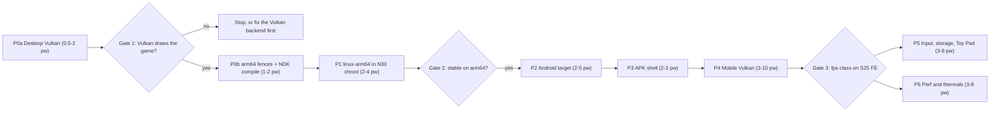

# Android feasibility: LEGO Dimensions recomp on Galaxy S25 FE and OnePlus Nord N30

**Agent 9, task #8 (resumes #33). v1.1, 2026-11-22 21:05 (v1 was 20:15).**

This was a read-only study. Nothing was built or run, no commands were used, and nothing was written to git.

**Sources.** My own reads, plus three read-only subagents:
- (a) SDK: report received 20:08-20:12;
- (b) Game: report received 19:50;
- (c) Android: report received about 19:55.

**Verification (v1.1).** The same three subagents re-checked about 349 citations against the source between 20:46 and 20:50:
- (b) checked §2 a1-a4 (127);
- (c) checked §0, §2 a5-a7 and §8 (≈115);
- (a) checked §1 and §3-7 (107).

Their corrections are merged. The main ones: where the xenos plugin comes from (§2 a3), isync (latent, not an arm64 blocker), `:412` (a cleanup, not a bug), the MAP_FIXED base probe, the Toy Pad lines, where `std::_Exit` lives, and the build cost. I re-read `updates.cpp`, `device.h`/`device.cpp`, `native_memops.cpp`, GAME `CMakeLists.txt`, `ui_theme.cpp`, `README-dev.md`, `legodimensions_app.h`, `rex_app.cpp` and the §4 c6 sources myself. What remains unverified is listed in §9.

Working notes are in `build/agent9/android/` (`notes-agent9.md`, `STATUS.md`, `prompts.md`).

**Legend**

- `path:line`: checked in this repo by me or a subagent.
- *(web)*: a secondary web source that was not checked on the phones.
- *(inferred)*: reasoning that was not verified.

**Paths**

- SDK = `DimensionsRecomp/rexglue-sdk`, GAME = `DimensionsRecomp/rexlego`, RM = `DimensionsRecomp/README.md`, FAC = `perf-notes/FINDINGS-AND-CHANGES.md`.
- Paths without a prefix are in SDK. This covers `src/…`, `include/…`, `thirdparty/…`, `resources/…`, `cmake/…`, `.github/…`, and a bare `CMakeLists.txt` or `CMakePresets.json`, which means the SDK root file.
- GAME paths start with `GAME/`.
- A bare file name is in SDK unless it is marked GAME. §10 gives the full paths.

---

## 0. Verdict

**Android is feasible, but it is a port project, not a build flag.** I estimate **≈17-42 person-weeks** for one experienced C++/graphics developer to reach a playable build on the S25 FE. That is about 4-10 months full-time. Optional touch controls add 1-3 person-weeks.

Three stop/go gates (§5) keep the expensive work behind cheap checks. The first two gates take ≈3.5-8 person-weeks, and they retire the two biggest risks before any Android-specific work starts.

| Area | State | Why |
|---|---|---|
| CPU / generated code | **Mostly ready** | linux-arm64 presets and CI exist, along with a NEON byte-swap, an aarch64 FPCR and an arm64 fault/MMIO decoder. The real gap is memory ordering. |
| GPU | **Biggest risk** | The only route is the SDK's rexgpu-xenos **Vulkan** backend. This project's default D3D12 builds don't use it, and the README calls it "not ready": it draws the world, but with darker colours and expected crashes. The game's native renderer is D3D12-only. |
| Android platform glue | **Missing, routine work** | CMake and SDL force X11/Wayland. There is no Android surface or main, fibers need ucontext, paths are relative to the exe folder, and there is no lifecycle handling. |
| Game features | **Mostly portable** | Audio and input go through SDL3. The Toy Pad picker is a Windows exe, so Android needs an in-app picker. |
| Phones | S25 FE: a 30 fps target is plausible *(inferred)*. N30: a dev/debug box, probably under 30 fps *(inferred)*. | §7 |

**Top blockers, in order**
1. **Memory ordering on arm64.**
   - sync, lwsync and eieio emit nothing (`src/codegen/builders/system.cpp:33-49`).
   - lwarx is a plain load (`src/codegen/builders/memory.cpp:209-216`).
   - Guest accesses are plain volatile (`resources/templates/codegen/pch_h.inja:133-145`).
   - Expect silent races that x86 never shows (§2 a5).
2. **The Vulkan path for this game.**
   - It is unused in this project's default D3D12 builds (`perf-notes/agent10-batch2-review.md:1659`). The README calls it not ready: it now draws the world, but colours are darker than intended and crashes are expected (RM:302-303,309-325).
   - Its required features, host render-target formats and MSAA support are unverified on Xclipse 940 and Adreno 619 (§2 a3).
3. **Android build and surface glue.**
   - X11/Wayland are REQUIRED: `src/ui/CMakeLists.txt:152-166`, `thirdparty/CMakeLists.txt:296-307`.
   - Two headers are missing: `surface_android.h` (`src/ui/vulkan/vulkan_presenter.cpp:36-37`) and `main_android.h` (`src/core/threading_posix.cpp:47-50`). `rex::GetAndroidApiLevel` is called (`threading_posix.cpp:76`, `src/core/memory_posix.cpp:94`) but never defined *(not grep-checked)*.
   - Fibers use ucontext, which bionic lacks (`src/core/fiber_posix.cpp:3,32,47,55,68`).
4. **Fault handling and mapping on POSIX.**
   - The SEH SIGSEGV and SIGILL handlers are replaced without chaining (`src/system/runtime.cpp:127`, `src/core/exception_handler_posix.cpp:420,436,439`). Unclaimed faults probably hang instead of crashing *(inferred)*.
   - It throws from a signal handler (`src/core/seh_posix.cpp:71-73`).
   - The guest-memory base probe maps with `MAP_FIXED` without reserving first (`src/system/xmemory.cpp:174-180,372-388`; `memory_posix.cpp:510-515`). On Android it could overwrite live ART or linker mappings *(inferred)*.
5. **Phone limits:**
   - 8 GB RAM, where the README recommends 16 GB (RM:413-417);
   - thermal throttling after ≈10 min on the S25 FE *(web)*;
   - ≈1.7 cores of spin-waiting on desktop (FAC:158).

**Cheapest first step, no phone needed (P0a).** On the user's PC, build the Windows game with `REXGLUE_USE_VULKAN=ON` and set `gpu_backend = vulkan` in `legodimensions.toml` (RM:316). The pass mark is that it draws the world and survives a play session. Darker colours are expected until the 16-bit texture-scaling fix lands (RM:318-323). If the Vulkan backend can't reach that on a desktop GPU, the Android work isn't worth starting.

---

## 1. The phones

| | Galaxy S25 FE | OnePlus Nord N30 5G (rooted) |
|---|---|---|
| SoC | Samsung Exynos 2400, 4 nm *(web)* | Snapdragon 695, 6 nm *(web)* |
| CPU | 10 cores: 1× Cortex-X4 3.21 GHz, 2× A720 2.9 GHz, 3× A720 2.6 GHz, 4× A520 1.95 GHz *(web)* | 8 cores: 2× A78 2.2 GHz, 6× A55 1.7 GHz *(web)* |
| Geekbench 6 single-core | ≈2,100-2,200 *(web)* | ≈900 *(web)* |
| GPU / API | Xclipse 940 (AMD RDNA3-based), Vulkan 1.3. Samsung's stock driver is the only option; Mesa Turnip doesn't apply *(web)*. | Adreno 619 (a6xx). Stock driver is Vulkan 1.1 (1.2 on some builds). Mesa Turnip supports a619 up to Vulkan 1.3, per app through adrenotools or system-wide with root *(web)*. |
| RAM / storage | 8 GB; no microSD *(web, unverified)* | 8 GB LPDDR4X; 128 GB UFS 2.2 plus microSD *(web)* |
| Cooling | Vapor chamber. CPU clocks drop after ≈10 min of stress, and GPU loop stability can fall below 50% *(web)*. | Mid-range passive cooling *(inferred)* |
| OS | Recent; not checked | Shipped with Android 13; one OS update, to Android 14 *(web)* |
| Kernel page size | Probably 4 KB *(unverified)* | Probably 4 KB *(unverified)* |
| **Role** | **Target device** | **Bring-up and debug box** (root gives chroot, simpleperf, `/dev/bus/usb` and Turnip) |

**Desktop reference numbers**
- **Uncapped title screen** (FAC:181): 163 fps, median 7.07 ms, p99 12.23 ms, on 3.52 cores.
- **At the 60 fps cap** (FAC:204): 2.12 cores.
- **Spin-waiting** (FAC:158): about 1.7 cores. The render-thread fence spin is 0.88 core and the TimerQueue spin 0.86 core.
- **Busiest threads** (FAC:196): GPU command 87%, TimerQueue 62%, main 48%, audio 6%. The heavy phase costs 2× CPU and 2.4× GPU (FAC:192).
- **The user's PC** (`perf-notes/BRIEF.md:48`): i7-1255U (2P+8E), 32 GB, MX570 plus Iris Xe. Session notes say its P-cores are capped near 1.9 GHz.
- **README** (RM:399-400, RM:413-417): the dev machine is a Ryzen 7 5700X3D with an RTX 4060. Recommended: 6+ cores and 16 GB RAM.
- **Content size** (RM:456-460): ≈9 GB for base + TU23, ≈24 GB with all 30 DLC.

---

## 2. (a) SDK: arm64 and POSIX readiness

| # | Item | Verdict | Effort |
|---|---|---|---|
| a1 | ARM64 CI, presets, CMake | Partial | 2-4 d |
| a2 | POSIX layers and bionic gaps | Partial; Android doesn't compile as-is | 6-12 d |
| a3 | Vulkan backend, SPIR-V translator, Android surface | Partial | 10-20 d, plus per-device bring-up |
| a4 | SIMDe, byte-swap, FP control | Mostly ready | 2-5 d, mainly validation |
| a5 | Memory ordering (sync/lwsync/eieio/isync, lwarx/stwcx.) | **Blocker** | 3-8 d, plus soak testing |
| a6 | Guest memory mapping and page size | Partial | 3-6 d |
| a7 | Exception handler and MMIO on arm64 | Partial | 3-6 d |
| | **SDK total** | | **≈29-61 d**, not counting GAME work or per-device GPU tuning |

### a1. ARM64 CI, presets, CMake: partial

**CI**
- arm64 CI exists. The release workflows run only on v-tags, and a nightly cron also builds linux-arm64:
  - `.github/workflows/build-linux-aarch64.yaml:3-6,14-18`;
  - `build-mac-arm64.yaml:3-6,16`;
  - `nightly.yaml:4-6` (cron plus workflow_dispatch); its linux-arm64 job is at `:110-119`, gated on should_build (`:112`).
- What `_build-platform.yaml` does:
  - `:30`: ubuntu-24.04-arm runners;
  - `:73-83`: clang 20;
  - `:104-111`: installs libvulkan-dev and the X11/Wayland packages;
  - `:123-126`: only builds and installs. **No tests run on arm64.**
- What is missing *(absent from every file read; not proven by a search)*:
  - There is no NDK job, no toolchain file and no windows-11-arm runner (the runner map at `_build-platform.yaml:30` has none).
  - `ANDROID` and NDK appear in no SDK or GAME CMake file or preset.
  - GAME has no CI of its own. `DimensionsRecomp/.github/workflows/native-gpu-checks.yml:3-18` only builds and tests (ctest) tools/gpu-aot on ubuntu-latest, on pull requests and on pushes to codex/native-renderer.

**Presets**
- SDK: `CMakePresets.json:89-94` (linux-arm64-base, `-march=armv8-a`) and `:126-129` (linux-arm64); `:80-85` (hidden windows-arm64-base, `-march=armv8-a`) and `:113-118` (win-arm64); `:97-106` (hidden mac-arm64-base, `CMAKE_OSX_ARCHITECTURES=arm64` at `:104`) and `:137-142` (mac-arm64).
- GAME: `GAME/CMakePresets.json:61-66,198-200`.

**CMake** (`CMakeLists.txt`)
- `:114-127`: Clang ≥18 is required.
- `:129-132`: 64-bit only.
- `:149-161`: non-x86 gets `-mcmodel=small`, and PIC is on for every non-Windows target. Both are fine for a JNI `.so`.
- `:164-172`: `-fno-strict-aliasing -ffp-model=strict -O3`.
- `:58-85`: the x86 baseline applies only on x86_64.
- `:174-213`: there is no Android branch. Android counts as `UNIX AND NOT APPLE`, so it lands in linux-arm64 (`:193-201`).

**Platform macros**
- `include/rex/platform.h:35-40`: Android sets `REX_PLATFORM_ANDROID` and `REX_PLATFORM_LINUX`, but not `GNU_LINUX`.
- Source census *(totals from report a; not re-verified)*: `__ANDROID__` or `REX_PLATFORM_ANDROID` appears on 42 lines in 13 files, left over from Xenia. Of those, threading_posix.cpp has 18, vulkan_presenter.cpp 4 and memory_posix.cpp 4. `__aarch64__` appears 4 times and `__ARM_NEON` 0 times. Spot checks: `vulkan_presenter.cpp:36,426,799` and `memory_posix.cpp:48,87,436`.

**Data point**: Windows on ARM shows a black screen (RM:295-296). The cause wasn't investigated here.

### a2. POSIX layers and bionic gaps: partial, and Android doesn't compile

**What exists**
- `src/core` has POSIX/Windows file pairs for atomic, clock, dbg, dynlib, exception_handler, fiber, filesystem, mapped_memory, memory, seh, socket, system and threading. Darwin shares the POSIX files (`src/core/CMakeLists.txt:56-76`).
- Linux is a real target: CI builds it, and Vulkan is ON off Windows (`CMakeLists.txt:34-43`).

**Already Android-aware**
- `src/core/memory_posix.cpp`: AndroidInitialize loads ASharedMemory from libandroid.so with dlopen and dlsym (`:93-103`). The mapping code uses it at `:434-458` (pointer at `:438-439`), with a `/dev/ashmem` fallback (`:444-458`).
- `include/rex/platform/dynlib.h:56-60`: Android library names, including `libvulkan.so`.

**Blockers**
- **Missing Android helpers.** `src/core/threading_posix.cpp:47-50` includes `rex/main_android.h`, which doesn't exist. `:76` calls `rex::GetAndroidApiLevel`, which has no definition *(not grep-checked; the header is missing either way)*.
- **A second compile failure in `memory_posix.cpp`.** AndroidInitialize also calls `rex::GetAndroidApiLevel` (`:94`), and its `main_android.h` include is commented out (`:56-57`). Xenia called AndroidInitialize from main_android, which isn't here *(inferred; callers not grep-checked)*. If nothing calls it, mapping falls back to `/dev/ashmem`, which the comment at `:444-445` says is disabled for apps targeting API 29+.
- **Fibers.**
  - `src/core/fiber_posix.cpp:3,32,47,55,68` uses getcontext, makecontext and swapcontext. Bionic doesn't provide these *(inferred; widely known)*.
  - Fibers are mandatory: every guest thread calls `Fiber::ConvertCurrentThread` (`src/system/xthread.cpp:663-666`), and the guest fiber APIs use them too (`src/kernel/crt/threading.cpp:91,162,243,328`).
  - Fix: a small aarch64 asm context switch.
- **Exe and data paths.**
  - `src/core/filesystem_posix.cpp:94-104` readlinks `/proc/self/exe`, which is `app_process64` inside an APK *(inferred)*.
  - `:106-124` uses the XDG folders: `XDG_DATA_HOME` at `:108-110`, `HOME` at `:112-115`, then a getpwuid_r fallback at `:117-123`.
- **The UI and SDL build is desktop Linux only.**
  - `src/ui/CMakeLists.txt:69-82` builds surface_gnulinux.cpp for every non-Windows, non-Apple target.
  - `:152-166` runs pkg-config with `REQUIRED x11-xcb wayland-client`.
  - `thirdparty/CMakeLists.txt:296-307` forces SDL X11, Wayland, ALSA, Pulse and PipeWire ON.
  - `src/ui/window_sdl.cpp:38-41` includes `X11/Xlib-xcb.h`.
- **Linking.** `src/core/CMakeLists.txt:103-104` links pthread, rt and dl. Bionic has these inside libc, and `-lpthread`/`-lrt` may not exist in the NDK *(inferred)*.
- **Scheduling.**
  - Thread affinity is an empty TODO (`threading_posix.cpp:176`).
  - The priority path uses SCHED_FIFO (`threading_posix.cpp:852-861`), which fails with EPERM for an app without root (report c).

### a3. Vulkan backend, SPIR-V translator, Android surface: partial

**Build** (`src/graphics/CMakeLists.txt`)
- `:1-5,101`: rexgpu-xenos is a SHARED plugin.
- `:36-44`: the SPIR-V translator.
- `:47-57`: the Vulkan backend (command processor, pipeline cache, primitive processor, render-target cache, shared memory, texture cache).
- `:90-92`: both are added under `REXGLUE_USE_VULKAN`. D3D12 and DXBC are added under `REXGLUE_USE_D3D12` (`:59-99`).
- `:143-154`: links glslang and VMA.
- The UI's Vulkan code is at `src/ui/CMakeLists.txt:37-52,91-92`.

**Defaults** (`CMakeLists.txt:34-43`): D3D12 is Windows-only and ON there. Vulkan is OFF on Windows and ON elsewhere, so a Linux or Android build gets Vulkan only.

**Backend selection**
- The `gpu_plugin` cvar (`src/ui/rex_app.cpp:61-64`) defaults to "", which "disables GPU emulation". The `gpu_backend` cvar (`:66-69`) defaults to `any`.
- `SetupPresentation` reads `gpu_plugin` (`:428`), calls the app's `OnPreSetup` (`:433`), and calls `LoadGpuPlugin` only if a plugin is named (`:435-436`). A failed load is fatal (`:437-444`).
- `src/graphics/plugin_main.cpp:40-52` tries d3d12 first, then vulkan.
- GAME sets the plugin only in native D3D12 builds. `legodimensions_app.h:105-170` is all `#ifdef LEGODIMENSIONS_NATIVE_GPU`. Its `OnPreSetup` (`:108-116`) fills in `xenos` only in PM4-reference mode (`:110-112`) and otherwise clears the plugin (`:114-115`).
- So the default build, the only kind Android can use, must get `xenos` from somewhere else. That wasn't found in GAME `src/` (top level), `main.cpp`, `CMakeLists.txt` or the two GAME toml files, and GAME/generated wasn't searched. GAME `CMakeLists.txt:175` passes no `GPU_PLUGINS` to `rexglue_setup_target`, and `cmake/rexglue_helpers.cmake:145-167` stages only the plugins listed. An Android build must set `gpu_plugin = xenos` and package the plugin itself.

**Plugin lookup**: `src/system/gpu_plugin_loader.cpp:40-46` opens `librexgpu-<name>.so` from the exe folder (`:57-65`). **That breaks on Android.** Load it from `nativeLibraryDir`, or link it statically.

**API minimum: none is enforced, and Vulkan 1.1 is fine in code.**
- `src/ui/vulkan/vulkan_device.cpp:76-90`: if the instance is below 1.1, the device is treated as 1.0.
- `vulkan_instance.cpp:344` chooses the instance apiVersion.
- `vulkan_device.cpp:153-244` requests promoted extensions only below their core version.
- `src/graphics/pipeline/shader/spirv_translator.cpp:63-72` picks SPIR-V 1.0, 1.3, 1.4 or 1.5 per device.
- So the Adreno 619 risk is features and formats, not the version number.

**Required features; the device is rejected without them**
- independentBlend, fragmentStoresAndAtomics and vertexPipelineStoresAndAtomics: `vulkan_device.cpp:95-125` (independentBlend at `:96-111`). The two stores-and-atomics features are checked again at `src/graphics/vulkan/command_processor.cpp:926-937`.
- geometryShader and fillModeNonSolid are required by default on non-Mac platforms. The cvars `vulkan_require_geometry_shader` and `vulkan_require_fill_mode_non_solid` are set at `vulkan_device.cpp:33-42` and enforced at `:126-139`. Setting them false switches to fallback paths (`command_processor.cpp:938-961`).

**Optional features, used if present** (`vulkan_device.cpp:213-244,629-732`)
- Core: tessellation, sampleRateShading, depthClamp, anisotropy, clip and cull distance, sparse.
- Vulkan 1.2: mirror-clamp and scalarBlockLayout.
- Vulkan 1.3: dynamicRendering (`command_processor.cpp:67,3096`) and demote.
- Extensions: EXT fragment_shader_interlock, non_seamless_cube_map, custom_border_color, robustness2, and KHR_portability_subset.

**BC textures**: there is no `textureCompressionBC` gate. Formats are probed one by one, with a decompress-to-RGBA8 fallback (`src/graphics/vulkan/texture_cache.cpp:2456-2474`). On a GPU without BC, that costs memory and bandwidth *(inferred)*.

**Render targets** (`render_target_cache.cpp`)
- `render_target_path_vulkan` defaults to empty (`:40-42`), which selects host render targets (`:209-213`).
- The FSI path needs interlock, fragmentStoresAndAtomics, sampleRateShading and standardSampleLocations (`:203-208,236-238`).
- Host render-target setup needs:
  - R16G16 and R16G16B16A16 attachments in SNORM or SFLOAT (`:278-319`);
  - R16G16B16A16_UNORM, because `gamma_render_target_as_unorm16` defaults to true (`src/graphics/flags.cpp:24`; check at `:320-335`);
  - several UINT formats with integer-sampled MSAA at 1×, 4× and also 2×, because `native_2x_msaa` defaults to true (`flags.cpp:18`; check at `:336-415`).
- If a check fails, it falls back to FSI. Without FSI, which these GPUs probably lack *(inferred)*, the check returns false, render-target-cache initialisation fails and the Vulkan backend doesn't start (`:310-317,328-333,408-413`). The 2× integer-sample requirement applies only when the device offers 2× attachments (`:373-380,400`), and the 4× check passes when 4× colour isn't offered at all (`:393-395`). Expect to change these cvars.

**Android surface: mostly there, but one file is missing**
- What exists:
  - `vulkan_instance.cpp:153-156` requests `VK_KHR_android_surface`.
  - `include/rex/ui/vulkan/api.h:29-33` defines `VK_USE_PLATFORM_ANDROID_KHR`.
  - `src/ui/vulkan/vulkan_presenter.cpp:426-428,799-808` creates the surface with `vkCreateAndroidSurfaceKHR`.
  - `include/rex/ui/surface.h:30-31,42` defines an AndroidNativeWindow surface type.
- What's missing:
  - `vulkan_presenter.cpp:36-37` includes `rex/ui/surface_android.h`, which doesn't exist. `include/rex/ui` has only the gnulinux, mac and win headers *(no directory listing was done)*.
  - `window_sdl.cpp:385-433` creates only HWND, Metal, Wayland and XCB surfaces, with Wayland and XCB at `:411-431`.

**Maturity**
- `perf-notes/agent10-batch2-review.md:1659`: the Vulkan backend is unused in this project's default D3D12 builds.
- README (RM:302-325): "not ready". It draws the world, but the 16-bit-texture ×65535 branch is disabled, so colours are darker, and it says "expect crashes".
- One perf snapshot has `REXGLUE_USE_VULKAN=OFF` (`perf-notes/agent6-crash-triage.md:79`), which is the SDK default on Windows (`CMakeLists.txt:34-43`). Release builds evidently include Vulkan, since RM:316 tells users to set `gpu_backend = vulkan` *(inferred)*.
- The README's system requirements say AMD cards show black or missing geometry (RM:419-426). That most likely refers to the default D3D12 path, not Vulkan *(inferred; RM:302-303)*. Xclipse is AMD-based, so watch for it anyway.

**Check on each phone with vulkaninfo**
- the 5 required features;
- FSI support;
- format features for R16G16 and R16G16B16A16 in SNORM, SFLOAT, UNORM and UINT, for R32 and RG32 UINT, and for D24S8;
- `sampledImageIntegerSampleCounts`, `maxStorageBufferRange` and `sparseBinding`.

### a4. SIMDe, byte-swap, FP control: mostly ready

**SIMDe**
- It is vendored (`thirdparty/CMakeLists.txt:102-106`) and linked by codegen, core and system (`src/codegen/CMakeLists.txt:115`, `src/core/CMakeLists.txt:110`, `src/system/CMakeLists.txt:85`).
- Code uses the `simde_` API, with no native aliases.

**Generated code**
- `include/rex/ppc/intrinsics.h:20-27` includes SIMDe SSE, SSE4.1, AVX and AVX2, plus `arm_neon.h` on aarch64.
- `:256-316` has an AVX2 fast path, and SSE4.1 otherwise.
- Codegen emits `simde_mm` calls: `src/codegen/builders/builder_context.h:290-311`, `context.cpp:606-656`, `floating_point.cpp:65-95`.

**FPSCR**: `include/rex/platform/fpscr.h:53-83` drives the real aarch64 FPCR with mrs and msr.

**Byte-swap**: arm64 is covered. These are the helpers that GAME `CMakeLists.txt:835-839` says need SSSE3.
- `src/core/memory.cpp:46`: the SSSE3 path on x86-64.
- `:205-226`: a NEON path using `vqtbl1q_u8`.
- `:321-326`: a generic fallback.
- The x86-64-v2/v3 flags apply only on x86_64 (`CMakeLists.txt:58-85`; GAME `CMakeLists.txt:823-857`). The same x86_64-only block (GAME `:843-844`) holds GAME's only `-O3` for `legodimensions_recomp` (`:849-851`). So an arm64 build of the generated code needs its own `-O3`, or RelWithDebInfo gives it CMake's `-O2` *(inferred, unless the SDK's flags reach GAME targets)*.

**x86-only code** *(counts from report a; not re-verified)*
- Raw `_mm_` intrinsics: 198 lines in 17 files. The SDK uses are arch-guarded:
  - `include/rex/audio/conversion.h:24,112`;
  - `src/audio/xma_context.cpp:755,800`;
  - `primitive_processor`;
  - `memory.cpp`.
- The rest are in `GAME/src/gpu_native`, which is Windows-only. There is also an arch-guarded `_mm_pause` in GAME `src/native_heap_journal.h:56-58` (include guarded at `:6-8`), which is harmless on arm64.
- `_mm_pause` appears at 4 sites, all guarded (`src/kernel/xboxkrnl/xboxkrnl_rtl.cpp:18-22,413-417`, among others). There are no `__rdtsc` or cpuid uses.

**Risk**: SIMDe emulates 256-bit AVX on 128-bit NEON, which is slower. VMX NaN and denormal behaviour needs testing *(inferred)*.

### a5. Memory ordering: **blocker**

**No-op barriers** (`src/codegen/builders/system.cpp`)
- sync (`:33-37`) and lwsync (`:39-43`) each contain only the comment "x86 has strong ordering so this is a no-op" and return true. No code is emitted.
- eieio (`:45-49`) is the same. `perf-notes/agent8-runtime.md:25` notes this too.

**isync: latent, not an arm64 blocker**
- `src/codegen/ppc/opcode.cpp:145,611-612` decodes isync, but that is a separate decoder with its own enum. The dispatch path keys on `PPC_INST_*` ids from the disassembler headers (`src/codegen/instruction_dispatch.cpp:20-22,641`), and isync has no entry in its table (`:317-325`).
- Any instruction without an entry emits `REX_UNIMPLEMENTED` (`:657-662`), which throws (`resources/templates/codegen/pch_h.inja:260-261`).
- That would fail on Windows too, and the Windows build runs, so the game probably never executes isync. Cheap check: look for "Unimplemented: isync" in the codegen log (`:659`) or "// UNIMPLEMENTED: isync" in the generated code (`:660`).

**Reservations**
- lwarx is a plain load into `ctx.reserved` (`src/codegen/builders/memory.cpp:209-216`, `helpers.h:286-296`).
- stwcx. calls `__sync_bool_compare_and_swap` against the reserved value (`memory.cpp:412-419`, `helpers.h:308-325`). That is a full-barrier value CAS that tolerates ABA, so the read-modify-write points are ordered, but the code around them is not.

**Existing fences and guest accesses**
- Only two instructions emit fences: mfmsr emits a seq_cst fence plus a global-lock check (`system.cpp:250-259`), and mtmsrd a fence plus global-lock enter/leave (`:318-335`).
- Guest accesses are volatile plus bswap: `pch_h.inja:133-145`; the `REX_MM_` macros at `:155-239`; GAME `generated/default/legodimensions_pch.h:125-137`.

**Consequence**
- volatile stops the compiler from reordering, but it emits no hardware barrier.
- x86-TSO only reorders store-to-load. arm64 also reorders load-load, load-store and store-store.
- Lock releases (lwsync, then a plain stw) and flag handoffs between threads become racy. The result is rare corruption or hangs that never show on x86.

**Native hooks tuned on TSO**
- GAME `native_lock_elide.cpp:40-46`: `LEGO_NATIVE_LOCK_ELIDE` is on by default.
- GAME `native_atomics.cpp:35-49`.
- Start arm64 with `LEGO_NATIVE_LOCK_ELIDE=0`.

**Fix**: gate it on `REX_ARCH_ARM64` or a codegen option, so x86 output stays byte-identical. Then regenerate GAME and soak-test.

| Instruction | Emit on arm64 | Where |
|---|---|---|
| sync | seq_cst fence (`dmb ish`) | `system.cpp:33-37` |
| lwsync | acq_rel fence (`dmb ish`); `dmb ishld` alone doesn't order store-store | `system.cpp:39-43` |
| eieio | release fence or `dmb ishst` | `system.cpp:45-49` |
| isync | new `build_isync` with an acquire fence, plus a dispatch entry | near `instruction_dispatch.cpp:317-325` |
| lwarx (optional) | `__atomic_load_n` with acquire | `helpers.h:292` |

Measure the `dmb` cost on hot lock paths.

**Why this should be enough for guest code** *(inferred)*: PowerPC is itself weakly ordered, and arm64's model is stronger than PPC's. Guest code was written with the barriers it needs. Translating them faithfully should cover guest code, so the TSO assumptions mainly live in the native hooks.

### a6. Guest memory mapping and page size: partial

**Mapping** (`src/system/xmemory.cpp`)
- `:149-153`: one shared mapping of 0x120000000 bytes (4.5 GiB) plus one allocation granule.
- `:171-186`: the base is probed at 4 GiB, then 8 GiB, and up. Each candidate goes through MapViews (`:174-180`, `:372-388`), which calls MapFileView with `MAP_FIXED` without reserving the range first (see **Clobber risk** below).
- `:188-189`: `virtual_membase` is the base, and `physical_membase` is base plus 0x100000000.
- `:280-325`: physical mirror views. For example, 0xE0000000 maps to offset 0x100001000 (`:315-317`).
- Host VA is about 0x100000000-0x220000000, which fits easily in a 39-bit (512 GiB) user VA. See also the "custom mmap at 0x100000000" note at `CMakeLists.txt:262-268`.
- The backing is `src/core/memory_posix.cpp:434-489`. A 4.5 GiB ashmem region is untested *(inferred)*, and on Android it needs AndroidInitialize to have run (§2 a2).

**Page size**
- `memory_posix.cpp:114-118`: `page_size` and `allocation_granularity` both return `getpagesize()`.
- Guest heaps (`xmemory.cpp:196-213`) use 4 KiB pages for v00000000, v90000000, physical and vE0000000, 64 KiB pages for v40000000, v80000000 and vA0000000, and 16 MiB pages for vC0000000 (`:210-211`).

**16 KiB-page kernels**
- At runtime, `host_address_offset` becomes 0x1000 when the granularity is above 4 KiB (`xmemory.cpp:1957-1968`).
- But codegen hard-codes `REX_PHYS_HOST_OFFSET` to 0 on Linux and Android:
  - `pch_h.inja:127-131`;
  - `include/rex/system/xmemory.h:31-47`, with the comment "Linux, any: 4KB granularity" at `:40`;
  - GAME `generated/default/legodimensions_pch.h:119-123`.
- Result: every access at 0xE0000000 and above would be off by 4 KiB.
- Write-watch works per host page (`xmemory.cpp:973-980,1065-1067,1290,2201-2203`), so invalidation gets coarser.
- This is latent on both phones if they have 4 KiB kernels *(unverified)*. It matters for Play's 16 KB rule *(web)*. `-z max-page-size=16384` isn't used anywhere.

**Clobber risk**: MapFileView uses `MAP_FIXED` (`memory_posix.cpp:500-531`, flag at `:510-515`), which silently replaces existing mappings. The comment at `:510-512` says this is deliberate, to replace reservations. But the base probe calls it at each candidate base without a reservation (`xmemory.cpp:174-180,372-388`), so it can overwrite live mappings. On Android those could be ART, linker or heap regions *(inferred)*. AllocFixed uses `MAP_FIXED_NOREPLACE` (`:240-317`).

### a7. Exception handler and MMIO on arm64: partial

**MMIO path**: MMIO normally goes through explicit calls. The `REX_MM_` macros call CheckLoad and CheckStore (`src/system/mmio_handler.cpp:50-53,105-124`). Faults are used only for write-watch and an MMIO-range fallback (`:371-527`, `:404-424`).

**The arm64 path exists**
- `mmio_handler.cpp:267-359`: an LDR/STR decoder; `:438-521`: register writeback.
- `src/core/exception_handler_posix.cpp`:
  - `:133-161` parses the ucontext FPSIMD and ESR records;
  - `:224-250` uses the ESR WnR bit or falls back to decoding, with an Android NDK comment at `:231-234`;
  - `:396-415` is the non-Mac writeback: X loop `:397-400`; sp, pc and pstate `:401-403`. **Cleanup at `:412`**: a stray line in the V-register loop (`:408-413`) rewrites X registers with values that are already there (`:134`, `:397-400`). For V31 it indexes one past the end of both arrays (`include/rex/exception_handler.h:299-300`). That is undefined behaviour, but in practice it does sp := sp. It is rarely reached (`mmio_handler.cpp:470-472`), and the macOS loop (`:388-395`) doesn't have it.

**Install**: `exception_handler_posix.cpp:428-458` installs SIGILL (`:436`) and SIGSEGV (`:439`) with `SA_SIGINFO`. SIGBUS is installed only on Mac (`:442-446`); the callback's SIGBUS case is at `:170-179`.

**Guest SEH without `__try`**
- How it works:
  - `include/rex/platform/exceptions.h:118-145`: `SEH_TRY` opens a scope with a SehGuard, then a native try/catch. Windows uses `__try` (`:107-116`).
  - `src/core/seh_posix.cpp:103-117` installs SIGSEGV, SIGBUS, SIGFPE and SIGILL handlers with `SA_NODEFER` and no chaining.
  - `:71-73` throws SehException from inside the signal handler. Outside a guarded region, `:36-41` resets to SIG_DFL and re-raises.
- Compiler flags: `-fasync-exceptions` is set on WIN32 only (`resources/templates/init/rexglue_cmake.inja:38-45`; GAME `generated/rexglue.cmake:38-47`).
- Throwing through a signal frame isn't guaranteed with LLVM libunwind on Android *(inferred)*.
- **Mitigation**: SEH scopes are emitted only when `generateExceptionHandlers` is set. It defaults to false (`include/rex/codegen/config.h:102`; macros at `function_graph.cpp:700-727`), and a 12-TU sample had 0 `SEH_TRY` (report c).

**Ordering bug on all POSIX platforms**
1. `src/system/runtime.cpp:127` calls `initialize_seh` before memory init (`:149-150`). Through `exceptions.h:89-91` that reaches `seh_posix.cpp:103-117`, which installs its handlers with `SA_SIGINFO|SA_NODEFER` (`:111`) and throws away the old ones (`:113-116`).
2. Memory init (`xmemory.cpp:236-239`) then calls `MMIOHandler::Install`, which calls `ExceptionHandler::Install` (`mmio_handler.cpp:53`).
3. `exception_handler_posix.cpp:436,439` replaces the SEH SIGILL and SIGSEGV handlers. SIGBUS and SIGFPE stay with seh_posix on Linux and Android.
4. A fault nobody claims returns at `:420` without calling `original_sigsegv_handler_`. That handler is restored only at uninstall (`:484-486`). SetCrashReporter is a no-op (`:424-426`).
5. Result: guest SEH never sees SIGSEGV or SIGILL on Linux or Android. An unclaimed fault re-runs the faulting instruction, so host crashes outside guarded code probably hang instead of reaching SIG_DFL and re-raise (`seh_posix.cpp:36-41`) *(inferred)*.

**Android extra** *(inferred, general knowledge)*: ART uses SIGSEGV for implicit null checks and stack overflow, and handlers installed with sigaction go through libsigchain. The handler must claim only guest or shared-memory faults and chain everything else.

---

## 3. (b) Game

| # | Item | Verdict | Effort |
|---|---|---|---|
| b1 | Renderer: default xenos path vs native D3D12 | Use xenos Vulkan. Native stays Windows-only. | 2-5 d desktop wiring; 20-60 d for phone GPUs; porting native to Plume-Vulkan 50-100+ d (**not recommended**) |
| b2 | Shader packs | None needed on the xenos path | inside P4 (pipeline cache) |
| b3 | Toy Pad | The emulated pad is portable; the picker is Windows-only | picker 5-15 d; USB 5-10 d |
| b4 | Audio | Portable (SDL3 plus FFmpeg XMA) | 1-4 d |
| b5 | Input | Gamepad is portable; no touch | 2-4 d (+5-15 d for touch) |
| b6 | File I/O and content | Portable VFS; paths relative to the exe folder | 4-10 d |
| b7 | Windows-isms in GAME | Small, with 1 compile error | 3-6 d |
| b8 | Generated-code build | arm64 presets exist | 3-7 d |

### b1. Renderer

**Default path**
- `LEGODIMENSIONS_NATIVE_GPU` is OFF by default (GAME `CMakeLists.txt:19-22`). The shipping renderer is the SDK's rexgpu-xenos plugin.
- The plugin comes from the SDK's `gpu_plugin` cvar, which defaults to off. GAME sets it only in native PM4-reference builds (`legodimensions_app.h:105-116`), and where the default build gets `xenos` wasn't found (§2 a3). The backend comes from the `gpu_backend` cvar.

**The native renderer is D3D12-only** (GAME `CMakeLists.txt`)
- `:61-64`: configure fails off Windows.
- `:89-99`: Plume, with `plume_vulkan` stripped: "This build is deliberately D3D12-only".
- `:233`: links `plume d3d12 dxgi`.
- `:236-248`: the FidelityFX FSR3 DX12 x64 libraries and DLL.
- `:264-273,310-321,353-380,566-577`: DXIL-only shader banks.
- `:319-321,444-452`: it already handles Windows-on-ARM64.

**Raw D3D12 vs Plume** in `GAME/src/gpu_native` (report b counts; subagent a re-counted the first two, not the downcasts)
- `plume::` is on 953 lines in 40 files. `ID3D12*` is on 118 lines in 16 files, and there are 105 D3D12 downcasts in 21 files.
- The native renderer's own device front end (GAME `src/gpu_native/device.h`; it wraps Plume and is not part of it) has a Backend enum with a kVulkan slot (`:44-47`, kVulkan at `:46`). `HostDevice::Create` defaults to kD3D12 (`:110`). `CreateInterface` (GAME `src/gpu_native/device.cpp:339-349`) returns nullptr for kVulkan (`:343-346`). The comment at `:344-345` says the slot is deliberate: the Plume Vulkan implementation "is compiled back in once the D3D12 command path is stable".
- `plume_vulkan.cpp` is vendored at `DimensionsRecomp/thirdparty/plume/plume_vulkan.cpp` (≈231 KB, outside GAME) but not compiled. The fingerprint list names `tools/gpu-aot/patches/plume-vulkan-readback.patch` (GAME `CMakeLists.txt:603`).
- So a Plume-Vulkan port means rewriting every raw-D3D12 escape hatch, plus the shaders and FSR3. Not recommended: the slot exists, but the 105 D3D12 downcasts mean the code above it is not backend-neutral.

**The project's own view of Vulkan**
- The UI calls Vulkan "unstable" (GAME `ui_theme.cpp:193-196`).
- One perf snapshot has it compiled out (`perf-notes/agent6-crash-triage.md:79`), which is the SDK default on Windows (§2 a3).
- `DimensionsRecomp/README-dev.md:310-312` (the monorepo root, not GAME), on Linux and macOS: "The SDK targets them, this game has only ever been built on Windows."

### b2. Shader packs

- **Native path**: DXIL banks embedded as COFF objects through llvm-mc. They can't be used with Vulkan.
- **xenos path**: Xenos microcode is translated to SPIR-V at runtime (`src/graphics/CMakeLists.txt:36-44`; the SPIR-V version is chosen per device, `spirv_translator.cpp:63-72`). No shader pack is needed.
- **On phones**: expect stutter the first time each shader compiles. Save the VkPipelineCache to app storage *(inferred)*. This is part of P4.

### b3. Toy Pad

**Emulated portal**
- On by default (`input_system.cpp:38-41`) and derived from RPCS3.
- POSIX socket paths exist (`src/input/portal/emulated_toypad.cpp:37-41,51-55,72-77`).
- It talks to the companion app over loopback TCP, port 9191 by default (`src/input/portal/emulated_toypad.cpp:162`). `REXGLUE_TOYPAD_PORT`, or the older `XENIA_TOYPAD_PORT`, overrides it (`:152-154`; `ListenerPort` at `:151-163`).
- The LOAD message is a header with command 0x01, a pad byte and an index (`:884-886`), then the 180-byte tag (`:906-907`; 0x2D × 4 bytes, an NTAG213 dump, `src/input/portal/emulated_toypad.h:29`), then a 2-byte little-endian path length (`:911-915`) and the path (`:917-924`). An in-app picker must send all of these.

**Picker**
- The picker is the `LegoToypad.exe` companion, started with CreateProcessW (GAME `toypad_app.cpp:102-198`, Windows-only). Off Windows, Launch only logs a warning (`:204-222`).
- The handoff uses the Windows named event `Local\CemuToypadPickerInputActive` (`emulated_toypad.cpp:80-85`).
- The companion's source wasn't found in the workspace.
- **Android needs an in-app picker**: an ImGui overlay or a small Kotlin screen that sends LOAD over the same socket.

**Real pad**
- The libusb `hardware_portal` is WIN32-only (`src/input/CMakeLists.txt:34-39,42-46`).
- USB IDs: 0E6F:0241 (HID), 24C6:FA01 (Xbox 360 XUSB), 0E6F:0141 (Xbox One GIP).
- The Android OTG routes are in §4 c6.

**Lifecycle**: closing the window hard-exits with `std::_Exit(0)` in the SDK's `ReXApp::OnClosing` (`src/ui/rex_app.cpp:706`, function `:693-707`), as the comment at GAME `toypad_app.cpp:131-136` notes. That's a gap on Android.

### b4. Audio

- SDL3 output plus FFmpeg XMA decoding (`AV_CODEC_ID_XMAFRAMES`). FFmpeg has an arm64 NEON config.
- The x86 intrinsics in `xma_context.cpp:755,800` are guarded (§2 a4).

### b5. Input

- SDL3 is the default. XInput is Win32-only (`src/input/CMakeLists.txt:34-39`).
- There is no touch driver, and finger events are filtered out (`sdl_input_driver.cpp:77`).

### b6. File I/O and content

- The VFS does case-insensitive lookup (`host_path_device.cpp:59-108`). That's good on Android's case-sensitive storage.
- All roots are cvars (`rex_app.cpp:227-262`), but the config TOML and the logs live in the exe folder (`:210-225,288-291`).
- GAME also uses exe-relative paths: `mod_menu.cpp`, `ui_theme.cpp:423` and `updates.cpp`.
- Size: ≈9 GB, or ≈24 GB with all DLC (RM:456-460).

### b7. Windows-isms in GAME

- **Compile error** *(inferred)*: GAME `src/updates.cpp:198` calls `_wcsnicmp` (a Microsoft CRT function) inside the starts_with lambda (`:194-203`) of `RelocateMovedInstall` (`:179`). That is outside the file's `_WIN32` blocks (`:21-23,52-76,116-176`), the file is always built (GAME `CMakeLists.txt:53`), and no shim was found, so a non-Windows build should fail. Fix: a portable case-insensitive compare (`wcsncasecmp` on glibc, or a `towlower` loop).
- `updates.cpp`: the updater is `rexupdate.exe` (`ResolveUpdater` at `:44-50`, path at `:49`). It is started with CreateProcessW at `:65-67` and `:134-135`, both inside the `_WIN32` blocks. Elsewhere the check only logs "Update checks are Windows-only for now" (`:174-176`).
- `discord_presence.cpp`: named-pipe IPC (`:3-11`). The windows.h include is guarded at `:36-40`, the pipe code at `:165-400`, and Start and Stop at `:404-436`. Off Windows, Start and Stop are empty stubs (`:429-435`), and the comment at `:431-432` says the unix-socket IPC isn't wired up.
- `sample_profiler.cpp`: the whole file is `_WIN32` (`:21,326`).
- GAME `CMakeLists.txt`: the TT lock trace (`:147`) and the native binary cache (`:444-468`) are Windows-only.
- `cheat_engine.cpp`: the POSIX stubs treat all memory as readable and writable (GAME `src/cheat_engine.cpp:179-181,197-199,213-215`).

### b8. Generated-code build

**Size**: 886 files, 490 MB. That includes 440 `.cpp` files totalling 472.8 MB; the largest recomp TU is 1.87 MB, and `register.cpp` is 8.6 MB.

**Build setup**
- GAME `generated/rexglue.cmake`:
  - `:78-109`: the generated code is an OBJECT library with a PCH.
  - `:111-123`: `REXGLUE_HOST_CODEGEN_EXECUTABLE` lets a cross build run codegen on the host, which fits an NDK cross build from Windows.
- GAME `CMakeLists.txt`:
  - `:823-857`: x86 flags apply only on x86_64.
  - `:862-885`: ThinLTO is optional, capped at 2 jobs.
- arm64 presets exist (GAME `CMakePresets.json:61-66`), and `cmake/rexglue_helpers.cmake:47-63` sets armv8-a.

**Bug**: `native_memops.cpp:31` hard-codes the +0x1000 offset (§8).

---

## 4. (c) Android

| # | Item | Verdict | Effort |
|---|---|---|---|
| c1 | NDK/Clang build of SDK and generated code | Doable; CMake needs Android branches | 4-8 d |
| c2 | APK shell | Use the vendored SDL3 android-project | 5-12 d |
| c3 | Storage for the user's own game files | App-specific external folder | 5-10 d |
| c4 | Controllers | Work through SDL3 | 2-5 d |
| c5 | Touch | None today | 1-3 d (+5-10 d for an overlay) |
| c6 | USB-OTG Toy Pad | Two candidate routes (§4 c6) | 3-6 d (+2-4 d for the picker UI) |
| c7 | Threads, thermals, big.LITTLE | Needs work | 4-8 d, plus P6 |
| | **Total** | | **≈29-59 d** |

### c1. NDK build

**Toolchain**
- Use NDK r27+: SDK needs Clang ≥18 (`CMakeLists.txt:114-127`), and `std::jthread` (`timer_queue.cpp:226,238`) needs libc++ ≥18.
- Build arm64-v8a only (64-bit only, SDK `CMakeLists.txt:129-132`).

**SEH doesn't block the build.** Scopes are macros (`function_graph.cpp:700-727`), emitted only with `generateExceptionHandlers`, which defaults to false (`include/rex/codegen/config.h:102`).

**Changes needed**
- an Android branch in SDK CMake (`CMakeLists.txt:174-213`);
- drop the X11/Wayland requirements (`src/ui/CMakeLists.txt:152-166`, `thirdparty/CMakeLists.txt:296-307`);
- add `main_android` and `surface_android`, and fix the fibers (§2 a2);
- give the generated code its own `-O3` on arm64, because GAME's (`CMakeLists.txt:849-851`) is x86_64-only (§2 a4);
- link with `-z max-page-size=16384` to be ready for 16 KB pages *(web)*.

**Build cost**
- A full game build is estimated at 7,680-10,020 CPU-seconds, about 13-17 min at -j10 (`perf-notes/agent2-baseline.md:730`).
- Expect ≈35-55 min at -j4 on the user's PC *(inferred)*, and much longer under the grid's 2-thread rule.

**SDL3**: the submodule tracks release-3.4.x (`.gitmodules:59-62`), but the checkout is a 3.5.0 prerelease (`thirdparty/sdl3/include/SDL3/SDL_version.h:47,56,65`). Pin a 3.4.x release for Android.

### c2. APK shell

**Scaffolding**: the vendored `thirdparty/sdl3/android-project/` (SDLActivity, HIDDeviceManager) is the recommended shell. Today the entry point is a plain `main()` (`windowed_app_main_sdl.cpp:127-131`), so it needs `SDL_main`.

**Lifecycle**
- `windowed_app_context_sdl.cpp:99-181` ignores the background, foreground, low-memory and terminating events.
- What's needed:
  - pause the guest (`rex_app.h:291-295`, `SetGuestPaused`);
  - drop and recreate the VkSurface and swapchain when the surface is lost;
  - replace `std::_Exit(0)` in `ReXApp::OnClosing` (`src/ui/rex_app.cpp:706`, function `:693-707`; GAME `toypad_app.cpp:131-136` only comments on it).

**Window**: `window_sdl.cpp:385-433` handles HWND, Metal, Wayland and XCB only. Add an `SDL_PROP_WINDOW_ANDROID_WINDOW_POINTER` branch that produces the AndroidNativeWindow surface (`include/rex/ui/surface.h:30-31,42`).

**Paths**: the plugin and config are looked up through the exe folder (`gpu_plugin_loader.cpp:57-65`, `filesystem_posix.cpp:94-104`). Use `nativeLibraryDir` and the app's external files folder, from JNI or SDL's Android path helpers *(general knowledge)*.

### c3. Storage for the user's game files

**Recommended**: `/sdcard/Android/data/<pkg>/files/game`. It needs no permission, and the user copies files in over MTP/USB.
- **Alternative** for a sideloaded build: `MANAGE_EXTERNAL_STORAGE` ("All files access"), which can point anywhere, including the N30's microSD.
- **Not SAF**: `content://` URIs don't fit the path-based VFS.

The user dumps their own game, and the APK ships no game data. Allow ≈9-24 GB (RM:456-460). Uninstalling the app deletes `Android/data`, so keep a copy *(practical note)*.

### c4. Controllers

The SDL3 gamepad API works as-is over Bluetooth or USB.

### c5. Touch

There's no touch input today; finger events are filtered out (`sdl_input_driver.cpp:77`). For v1, require a gamepad *(recommendation)*.

### c6. USB-OTG Toy Pad

**Route A: libusb**
- Use the vendored `thirdparty/libusb/android/jni` (libusb 1.0.28, `thirdparty/libusb/libusb/version.h:4-10`), with `libusb_wrap_sys_device` and `LIBUSB_OPTION_NO_DEVICE_DISCOVERY`.
- The fd comes from Java's UsbManager, after the user grants permission.
- This reuses the `hardware_portal` logic, which is WIN32-only today.

**Route B: SDL hidapi**: HIDDeviceManager's Xbox 360 and Xbox One vendor lists include 0x0e6f and 0x24c6 (`thirdparty/sdl3/android-project/app/src/main/java/org/libsdl/app/HIDDeviceManager.java:242,256` and `:286,291`). The Xbox 360 match also checks the interface class, subclass and protocol (`:263-266`); whether the pad's interfaces pass wasn't checked.

**Protocol**: 32-byte LEGO frames (`src/input/portal/emulated_toypad.cpp:220,231`), read by the libusb portal with a 100 ms timeout (`include/rex/input/portal/hardware_portal.h:95`). An Xbox One (GIP) pad adds a 4-byte header (`:96-97`), so those reads use a 64-byte buffer (`src/input/portal/hardware_portal.cpp:144,256-264`).

**Testing on the rooted N30**: root can open `/dev/bus/usb` directly from a chroot before any APK work *(inferred)*. The pad needs bus power through an OTG adapter. Phone OTG power limits weren't checked, so a powered hub may be needed *(inferred)*.

### c7. Threads, thermals, big.LITTLE

**Threading today**
- About 20 guest threads run, one pthread each, on 6 fake guest CPUs. `ignore_thread_affinities` defaults to true.
- Affinity is a TODO (`threading_posix.cpp:176`), and SCHED_FIFO (`:852-861`) gives EPERM.
- CpuRelax becomes a yield on non-x86 (`xboxkrnl_rtl.cpp:412-418`).
- TimerQueue spins (`timer_queue.cpp:29-100`), and AlertableSleep polls in 1 ms slices.

**Spinning**: on desktop the fence and TimerQueue spins cost ≈1.7 cores (FAC:158). On a phone that is pure heat and battery.

**Plan** *(general knowledge / inferred)*
- Replace spins with futex or condition-variable waits.
- Pin the GPU command thread and the main thread to big cores; `sched_setaffinity` is allowed on an app's own threads.
- Use ADPF performance-hint sessions and the thermal-headroom API.
- Cap at 30 fps, with proper frame pacing.

**Per-core speed** vs a Golden Cove P-core capped at 1.9 GHz (report c, *inferred*):

| Core | Phone | Relative speed |
|---|---|---|
| Cortex-X4 3.2 GHz | S25 FE (×1) | ≈1.5-2× |
| Cortex-A720 2.6-2.9 GHz | S25 FE (×5) | ≈1.0-1.3× |
| Cortex-A78 2.2 GHz | N30 (×2) | ≈0.8-1.0× |
| Cortex-A520 / A55 | both (little cores) | ≈0.3× |

---

## 5. Phased plan

Effort is in **person-weeks (pw)**.

| Phase | Work | Effort | Where | Exit |
|---|---|---|---|---|
| **P0a** | Windows build with `REXGLUE_USE_VULKAN=ON` and `gpu_backend = vulkan`. Fix the obvious bugs. In parallel, run vulkaninfo on both phones against the a3 checklist. | 0.5-2 | user's PC | **Gate 1** |
| **P0b** | arm64 ordering in codegen (§2 a5), behind `REX_ARCH_ARM64` or an option. Regenerate, then compile all generated TUs with NDK Clang (objects only). | 1-2 | PC | x86 output byte-identical; every TU compiles for arm64 |
| **P1** | linux-arm64 (glibc) bring-up: GAME Windows-isms (b7), the `native_memops` fix, the a7 fault fixes, MAP_FIXED, `LEGO_NATIVE_LOCK_ELIDE=0`. Run in a chroot on the rooted N30 (with an X server app or headless), or on any arm64 Linux box. | 2-4 | N30 chroot | **Gate 2** |
| **P2** | Android target: CMake and SDL Android branches, asm fibers, `main_android`/`GetAndroidApiLevel`, `surface_android`, plugin path, pthread/rt, a 16 KB-safe link. | 2-5 | PC + N30 | links for arm64-v8a; loads the game and starts guest threads under adb |
| **P3** | APK shell: SDLActivity, `SDL_main`, lifecycle (pause/resume, surface loss), storage paths, settings. | 2-3 | both phones | the APK shows the title screen |
| **P4** | Mobile Vulkan: fallbacks for features and formats (geometry shader, host render-target formats, MSAA, BC), a pipeline cache on disk, a memory budget. Test Xclipse on its stock driver, and Adreno on stock and Turnip. | 3-10 | S25 FE first | **Gate 3** |
| **P5** | Input and Toy Pad: an in-app picker over TCP 9191 and storage UX. Optional: an OTG pad through libusb or hidapi, and a touch overlay. | 3-8 (+1-3 for touch) | both | play a level with characters added from the picker |
| **P6** | Performance and thermals: remove spins, pin to big cores, ADPF, a 30 fps cap and pacing, resolution scale, memory trimming. | 3-8 | S25 FE | 30 fps held for 30 min |
| | **Total** | **≈17-42** (+1-3) | | |

**Gates**
- **Gate 1, after P0a.** On the PC, the Vulkan backend draws the world and survives a play session (title, hub, one level), with only the expected darker colours (RM:318-323). No phone fails a required feature. **If not, stop**: every later phase depends on it.
- **Gate 2, after P1.** The arm64 build runs the attract loop and one level for ≥1 h with no hangs or corruption, with the fences on. Measure what the fences cost.
- **Gate 3, at P4's first frames on the S25 FE.** Decide between a 30 fps target, a lower-fidelity target, or stopping.

**Cross-check against the subagent estimates.** The subagent sums are 29-61 d (SDK), 29-59 d (Android) and ≈45-120 d (Game), and they overlap: Toy Pad, input, storage, the build and Vulkan each appear in more than one. With the overlap removed, they fall in about the same 17-42 pw range. The draft plan from session 1 said 16-37 pw. The top of the range went up because the subagents estimate phone-GPU work at 20-60 d and storage/Toy Pad UX at 16-39 d.

---

## 6. Risks

| # | Risk | Likelihood | Impact | Mitigation |
|---|---|---|---|---|
| R1 | The Vulkan backend can't render this game correctly. It is unused in this project's default D3D12 builds (`perf-notes/agent10-batch2-review.md:1659`), and the README calls it not ready: darker colours, crashes expected (RM:302-325). | High | High | Gate 1 on the desktop before any Android work |
| R2 | Mobile drivers and features. A required feature (`vulkan_device.cpp:95-139`) or host render-target format or MSAA mode (`render_target_cache.cpp:278-415`) may be missing. FSI fallback is probably unavailable *(inferred)*, and without it a failed check stops the Vulkan backend from starting (§2 a3). Xclipse runs only Samsung's driver, and AMD cards already show issues on the default D3D12 path (RM:419-426) *(inferred)*. | High | High | vulkaninfo on both phones in P0a; the cvar fallbacks (§2 a3); Turnip on the N30 to tell driver bugs from backend bugs |
| R3 | Weak memory ordering (§2 a5), plus native hooks tuned on TSO | Medium-High | High (heisenbugs) | Fences on arm64, `LEGO_NATIVE_LOCK_ELIDE=0`, soak tests in P1 |
| R4 | Fault and SEH handling: the SEH SIGSEGV handler is overwritten without chaining, SIGILL is taken over too (`exception_handler_posix.cpp:436`), unclaimed faults probably hang *(inferred)*, it throws from a signal handler, and ART's sigchain also handles SIGSEGV (§2 a7) | Medium | High | Fix chaining and the init order; keep `generateExceptionHandlers` off; claim only guest-range faults |
| R5 | Fibers on bionic (§2 a2) | Certain | Medium | An aarch64 asm context switch (≈100-200 lines) *(inferred)* |
| R6 | 16 KB pages vs the compile-time `REX_PHYS_HOST_OFFSET` (§2 a6) | Low on these phones *(unverified)* | High if hit | Run `getconf PAGE_SIZE` over adb; give Android the runtime offset; link 16 KB-aligned |
| R7 | RAM: 8 GB vs the recommended 16 GB (RM:413-417). The 4.5 GiB ashmem mapping is untested, and BC decompression to RGBA8 inflates texture memory *(inferred)*. | Medium | High (the low-memory killer kills the game) | Measure RSS on Linux in P1; set texture-cache budgets; handle trim-memory events |
| R8 | Thermals and big.LITTLE: the S25 FE throttles after ≈10 min *(web)*, and the N30 has only 2 big cores | High | Medium | 30 fps cap, spin removal (FAC:158), big-core pinning, ADPF |
| R9 | Toy Pad UX: the Windows companion can't be used | Certain | Medium | An in-app picker on the existing TCP 9191 protocol; OTG optional |
| R10 | Build and tooling: 490 MB of generated code, ≈35-55 min NDK builds *(inferred)*, an SDL3 prerelease checkout | Medium | Low | ccache, objects built once per regeneration, pin SDL3 3.4.x |
| R11 | Upstream drift: Android patches touch the SDK (CMake, codegen, core) | Medium | Medium | Keep the fixes gated (x86 byte-identical) and upstream them |
| R12 | Content and legal: the user must supply their own game files | n/a | n/a | The APK never bundles game data (§4 c3) |

---

## 7. What each phone is good for

| | **Galaxy S25 FE** | **OnePlus Nord N30 (rooted)** |
|---|---|---|
| Role | **The play target** | **Bring-up and debug box** |
| CPU fit | 1× X4 + 5× A720 for the three heavy threads (GPU command 87%, TimerQueue 62%, main 48%; FAC:196): enough *(inferred)* | 2× A78 for those three threads: tight; the A55s are ≈0.3× *(inferred)* |
| GPU fit | RDNA3-based, Vulkan 1.3, stock driver only. AMD-family issues are possible (RM:419-426). | Adreno 619: stock Vulkan 1.1, Turnip 1.3. Weak, but there's a second driver to compare against. |
| Expected after P6 *(inferred)* | **30 fps held at 1× resolution scale**; 60 fps in light scenes for short sessions before it throttles | Functional testing; probably **under 30 fps** |
| Best uses | Real play, perf and thermal tuning, Xclipse driver bugs, the final APK | P1 chroot bring-up with glibc (no bionic work needed yet); simpleperf and perfetto system-wide; Toy Pad testing through `/dev/bus/usb`; Turnip-vs-stock A/B; page-size and memory checks |
| Limits | No root, so a normal APK only; no microSD *(unverified)* | One OS update, to Android 14; 128 GB, but microSD helps with the 24 GB DLC set |

**The user's PC** runs P0a (Vulkan on Windows: the MX570 for NVIDIA and the Iris Xe as a weak-GPU proxy *(inferred)*). It also runs P0b's regeneration and arm64 compiles, and all CI-style builds.

---

## 8. Bugs found along the way (worth fixing whether or not Android happens)

Six bugs and one cleanup (row 3).

| # | Bug | Evidence | Affects |
|---|---|---|---|
| 1 | `native_memops.cpp` hard-codes +0x1000 for addresses ≥0xE0000000: `u8* Host(u8* base, u32 address) { return base + address + (address >= kPhysicalWindow ? 0x1000u : 0u); }`, with `kPhysicalWindow = 0xE0000000` at `:29`. The file is always built, with no platform guard (GAME `CMakeLists.txt:25,46`). On a 4 KiB Linux or Android host both the runtime offset (`src/system/xmemory.cpp:1957-1968`) and the compile-time `REX_PHYS_HOST_OFFSET` (GAME `generated/default/legodimensions_pch.h:119-123`) are 0, and the 0xE0000000 view is mapped at file offset 0x100001000 exactly (`src/system/xmemory.cpp:315-317`, rounding at `:376,381`), so these accesses land 4 KiB off. Fix it with `REX_RAW_ADDR`, as `native_atomics.cpp:36` does. | GAME `src/native_memops.cpp:29-31`; GAME `CMakeLists.txt:25,46`; `src/system/xmemory.cpp:315-317,1957-1968` | any Linux or Android build |
| 2 | `_wcsnicmp` (Microsoft CRT) is called outside every `_WIN32` block, inside a starts_with lambda. The file is compiled on every platform (GAME `CMakeLists.txt:53`) and no shim was found, so a non-Windows compile should fail *(inferred)*. Fix: `wcsncasecmp` or a portable case fold. | GAME `src/updates.cpp:198` (lambda `:194-203`; `_WIN32` blocks `:21-23,52-76,116-176`) | any non-Windows compile |
| 3 | *Cleanup, not a functional bug*: a stray line in the V-register loop rewrites unchanged X registers and, for V31, indexes one past the end (undefined behaviour, harmless in practice) | `src/core/exception_handler_posix.cpp:412` (V loop `:408-413`); `include/rex/exception_handler.h:299-300` | arm64 Linux, Android |
| 4 | The SEH SIGSEGV and SIGILL handlers are replaced by the MMIO handler, and unclaimed faults aren't chained, so host crashes outside guarded code probably hang *(inferred)* | `src/system/runtime.cpp:127,149-150`; `src/core/seh_posix.cpp:103-117`; `exception_handler_posix.cpp:420,436,439,484-486` | all POSIX |
| 5 | isync has no dispatch entry, so it would throw `REX_UNIMPLEMENTED` if executed. Latent: the Windows build runs, so the game probably never executes it. | `src/codegen/instruction_dispatch.cpp:20-22,317-325,641,657-662` | all platforms (check the codegen log for "Unimplemented: isync", `:659`) |
| 6 | MapFileView uses `MAP_FIXED` and can silently replace mappings, and the guest-memory base probe calls it at each candidate base without reserving first | `src/core/memory_posix.cpp:500-531` (flag `:510-515`); `src/system/xmemory.cpp:174-180,372-388` | all POSIX; on Android possibly ART or linker regions *(inferred)* |
| 7 | Compile-time `REX_PHYS_HOST_OFFSET` = 0 vs the runtime 0x1000 on kernels above 4 KiB | `resources/templates/codegen/pch_h.inja:127-131`; `include/rex/system/xmemory.h:31-47`; `src/system/xmemory.cpp:1957-1968` | 16 KB-page Linux and Android (macOS-arm64 already special-cased) |

---

## 9. Not checked / open questions

**Not checked**
- Real Vulkan feature, format and MSAA values on both phones. This needs vulkaninfo or a caps-viewer app on each phone; it's an optional user step.
- The kernel page size on both phones (`adb shell getconf PAGE_SIZE`).
- Whether the SDL3 checkout (a 3.5.0 prerelease) builds for Android.
- Whether the generated GAME code contains isync (check the codegen log for "Unimplemented: isync", §2 a5).
- Where the default (non-native) build sets `gpu_plugin = xenos` and stages the plugin. GAME `src/` (top level), `main.cpp`, `CMakeLists.txt` and the two toml files were read; GAME/generated wasn't searched (§2 a3).
- Absence claims, which come from reading files rather than a repo-wide search: no NDK job, `ANDROID` branch or toolchain file (§2 a1); `rex::GetAndroidApiLevel` undefined, and who calls AndroidInitialize (§2 a2); no `_wcsnicmp` shim (§3 b7).
- Counts and sizes from subagent reports that weren't re-verified: the `__ANDROID__` census (§2 a1), the x86-intrinsic counts (§2 a4), the 105 D3D12 downcasts (§3 b1), and the generated-code sizes (§3 b8, and the 490 MB in R10).
- The game's RSS and VRAM on desktop, and the Vulkan backend's speed on any GPU.
- Bionic's lack of ucontext. This is general knowledge, not checked here.
- Why Windows on ARM shows a black screen (RM:295-296).

**Open questions**
- Does the user want touch controls at all, or is a controller acceptable? This changes P5 by 1-3 pw.
- Is a real Toy Pad over OTG wanted, or is the in-app picker enough?

---

## 10. File index

These are the full paths for the bare file names cited above. Subagent (a) resolved them at 20:15 by exact-name search. Folders marked *(inferred)* come from context and weren't confirmed by a search.

**SDK** (`DimensionsRecomp/rexglue-sdk/`)

| File | Path under SDK |
|---|---|
| `input_system.cpp` | `src/input/input_system.cpp` |
| `emulated_toypad.cpp` | `src/input/portal/emulated_toypad.cpp` |
| `hardware_portal.cpp` | `src/input/portal/hardware_portal.cpp` (the libusb portal: `libusb.h` at `:15`, `libusb_init` at `:33`) |
| `sdl_input_driver.cpp` | `src/input/sdl/sdl_input_driver.cpp` |
| `host_path_device.cpp` | `src/filesystem/devices/host_path_device.cpp` |
| `xboxkrnl_rtl.cpp` | `src/kernel/xboxkrnl/xboxkrnl_rtl.cpp` |
| `timer_queue.cpp`, `seh_posix.cpp`, `exception_handler_posix.cpp`, `clock_posix.cpp`, `threading_posix.cpp`, `fiber_posix.cpp`, `filesystem_posix.cpp`, `memory_posix.cpp`, `memory.cpp` (byte-swap) | `src/core/` |
| `rex_app.h` | `include/rex/rex_app.h` |
| `rex_app.cpp`, `window_sdl.cpp`, `windowed_app_main_sdl.cpp`, `windowed_app_context_sdl.cpp` | `src/ui/` |
| `vulkan_device.cpp`, `vulkan_presenter.cpp`; `vulkan_instance.cpp` *(folder inferred)* | `src/ui/vulkan/` |
| `command_processor.cpp`, `texture_cache.cpp`; `render_target_cache.cpp` *(folder inferred)* | `src/graphics/vulkan/` |
| `plugin_main.cpp`, `flags.cpp` | `src/graphics/` |
| `spirv_translator.cpp` | `src/graphics/pipeline/shader/` |
| `gpu_plugin_loader.cpp`, `mmio_handler.cpp`, `xmemory.cpp`, `runtime.cpp`, `xthread.cpp` | `src/system/` |
| `function_graph.cpp`, `instruction_dispatch.cpp` | `src/codegen/` |
| `system.cpp`, `memory.cpp` (codegen), `builder_context.h`; `context.cpp`, `floating_point.cpp` *(folder inferred)* | `src/codegen/builders/` |
| `opcode.cpp` | `src/codegen/ppc/` |
| `pch_h.inja` | `resources/templates/codegen/` |
| `helpers.h` | `src/codegen/builders/helpers.h` (lwarx at `:286-296`, stwcx. at `:308-325`) |
| `_build-platform.yaml`, `build-linux-aarch64.yaml`, `build-mac-arm64.yaml`, `nightly.yaml` | `.github/workflows/` |

**GAME** (`DimensionsRecomp/rexlego/`)

| File | Path under GAME |
|---|---|
| `legodimensions_app.h`, `toypad_app.cpp`, `updates.cpp`, `native_memops.cpp`, `native_atomics.cpp`, `native_lock_elide.cpp`, `cheat_engine.cpp`, `ui_theme.cpp`, `mod_menu.cpp`, `discord_presence.cpp`, `sample_profiler.cpp` | `src/` |
| `device.h`, `device.cpp` (the native renderer's device front end) | `src/gpu_native/`. `device.h`: Backend enum at `:44`, kVulkan at `:46`, kD3D12 default at `:110`. `device.cpp`: CreateInterface at `:339-349`; its kVulkan case returns nullptr at `:343-346`. |
| `legodimensions_pch.h` | `generated/default/` |
| `rexglue.cmake` | `generated/` |

**Monorepo** (`DimensionsRecomp/`, outside SDK and GAME)

| File | Path |
|---|---|
| RM | `DimensionsRecomp/README.md` |
| `README-dev.md` | `DimensionsRecomp/README-dev.md` (not in GAME) |
| `plume_vulkan.cpp` | `DimensionsRecomp/thirdparty/plume/plume_vulkan.cpp`, next to `plume_vulkan.h` and `plume_d3d12.cpp` (not in GAME) |
| `native-gpu-checks.yml` | `DimensionsRecomp/.github/workflows/` |

**Notes and measurements** (`perf-notes/`): `FINDINGS-AND-CHANGES.md` (FAC), `BRIEF.md`, `agent2-baseline.md`, `agent6-crash-triage.md`, `agent8-runtime.md`, `agent10-batch2-review.md`.
