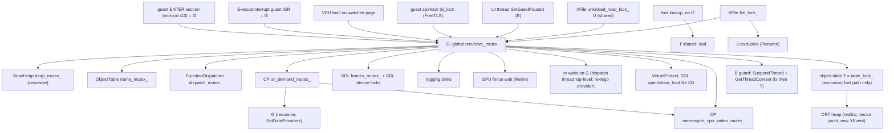

# Agent 12 / J3: global critical region ("G") map, lock-order graph and narrowing checklist

Status: **v2 (19:45): map, checklist and bench results (§7) complete, including S4 f/g (19:40).** Written 2026-11-21 by Agent 12's J3 subagent. Read-only analysis; no SDK or game code changed. The review of Agent 11's design built on this map is [agent12-gcr-review.md](agent12-gcr-review.md).
Sources: SDK `DimensionsRecomp/rexglue-sdk` at HEAD `2897c31` plus the working tree. Line numbers are working-tree numbers: §2.2 and everything marked "19:14" are as of 19:14, except that **every `object_table.cpp` number is as of 19:16** (Agent 11 then added the T-rules comment and the Restore asserts, +7 lines from L37); the rest are as of 18:15 (`xmemory.cpp` is +1 vs HEAD up to about L2140 and +12 after it).
- **Since v1, Agent 11 landed parts A, B and C** of `perf-notes/agent11-global-mutex-design.md` in the working tree. A is always on. B and C are behind cvars that default off: `guest_suspend_guard` (`xthread.cpp:44`) and `object_lookup_fast_path` (`object_table.cpp:27`, which also turns B on). The review's ask-1 fix landed too (`xobject.cpp:49-59`, `:490-495`). At 19:16 the T rules were written into `object_table.cpp:37-48`, and Restore/RestoreHandle gained `assert_true(table_write_depth_ == 0)` (`:564`, `:577`).
- **Agent 12 (task #11)** added `XFile::unlocked_read_lock_` ("U") and the lock-free `PhysicalHeap::MayHaveWriteWatches`. Their cvars `io_unlocked_file_reads` and `io_lockless_watch_check` both default false (`xfile.cpp:31`, `:39`).
- Paths: `object_table.cpp` is `src/system/util/object_table.cpp`. In H2, §2.5 rows 66-69 and §3, `command_processor.cpp` is `src/graphics/d3d12/command_processor.cpp`.

rexlego is at `DimensionsRecomp/rexlego` (src + untracked `generated/`).

Notation used below:
- **G** is `rex::thread::global_critical_region`.
- **Held across** codes:

| Code | Meaning |
|---|---|
| GC | guest code runs while G is held |
| APC | APC delivery while G is held |
| W | host or guest wait (event, cv, fence, sleep or spin) |
| IO | host file/device I/O |
| HCB | host callbacks (invalidation, watch, data provider, MMIO) |
| SYS | slow syscalls (VirtualProtect, SDL device open/close, D3D) |
| DTOR | `XObject::Release()` can hit 0 and run a destructor |
| LOG | logging while G is held |

---

## 0. Top hazards

| # | Hazard | Evidence | Severity |
|---|---|---|---|
| H1 | **G orphaned by thread death.** Host `TerminateThread` on a thread that is inside a G region (a generated ENTER section, a kernel G site, or the audio worker's G section at shutdown) leaves G owned forever, and the whole process hangs (every guest `mfmsr` takes G). MSVC `std::recursive_mutex` has no owner-death detection: S4 shows the lock orphaned at depth 2 and on plain thread return (§7.4). **19:14:** the only non-self `XThread::Terminate` caller is `AudioSystem::Shutdown` after a timeout, and `TerminateTitle` no longer force-kills (`kernel_state.cpp:1038-1040`). **Release-build unlock:** ownership is a TID compare and the owner check is debug-only, so a stray LEAVE on a held G decrements the owner's count and releases its SRW lock (exclusion broken), and on a free G it drives the count to -1 (G never unlocks again); S4 f1/f2 confirm both. **Killing a thread that is only *waiting* for G is worse (S4 g, 19:40):** the SRW wait block lives on the waiter's stack, the kill frees that stack, and the next `unlock()` or the next waiter crashes inside ntdll (3 of 3 variants). Any guest thread can be parked in G at any moment (every `mfmsr` takes it), so `TerminateThread` of any G-using thread can crash the process, not only hang it. | `xthread.cpp:566-585` (Terminate → host TerminateThread, 19:14) and Exit (`:513`); `pch_h.inja:324-335` (raw `mutex().lock()`/`unlock()` with no RAII); `audio_system.cpp:202-213` (comment: Shutdown may TerminateThread the worker, which takes G at L137); STL `mutex.cpp:78-160` | high (latent; shutdown only today; crash or hang) |
| H2 | **GPU fence wait while holding G** on a faulting guest thread. Path: MMIO fault takes G at `mmio_handler.cpp:408` → `Memory::AccessViolationCallback` → legacy data provider `ProvideOnDemandMemexportThunk` → `RetireOnDemandMemexport(true)` takes G again (recursive) → `on_demand_mutex_` → `WaitForSingleObject(on_demand_fence_event_, INFINITE)`. While it waits, all other guest threads block in `mfmsr` and in every G-taking export. **The wait depends only on the GPU:** Publish ends the submission before it publishes (`:3178-3181`, comment `:3226`), so this is a stall, not a deadlock. A B suspender of that thread also waits for the GPU. | `xmemory.cpp:570`; `command_processor.cpp:3219-3238`, `:3341-3351` (d3d12) | high (perf, every on-demand retire) |
| H3 | **The "locked once" contract is false.** `mmio_handler.h:51` says the access-violation callback gets G "locked once". The faulting thread may already hold G: it may be in an ENTER section, in a kernel export that writes guest memory while holding G, or in the guest ISR run by `ExecuteInterrupt`. Callees that drop the lock with `lock.unlock()`, then `wait`/`settle`, then `lock.lock()`, or with `cv.wait(lock)`, only drop one level. The thread then waits while still owning G, which deadlocks if the producer needs G. | rexlego `physical_dependency_provider.h` `Deliver` (L166-188) and `progress_` cv waits (L111, L115, L229). Same pattern in `entry_table.cpp:45-71` (unlock, `Sleep`, relock spin), but EntryTable has no users (dead code) | high (latent deadlock) |
| H4 | **Fixed by part A (19:14; `object_table.cpp:318-322`, always on).** Before A, `ObjectTable::RemoveHandle` called `LookupTable()` (which takes and drops G) and got a raw `ObjectTableEntry*` before it took G. A concurrent `AddHandle` → `Resize` (`realloc`) could free the old array, so `entry->object = nullptr` wrote into freed memory, and the live slot kept pointing at an object whose table reference was gone. S2 reproduced it: 153 stale-entry reads and 153 writes into freed blocks per 3 s, and 0 with A's order (§7.2). | v1 `object_table.cpp:178-215`. Callers without G: `NtDuplicateObject` with `DUPLICATE_CLOSE_SOURCE` (`xboxkrnl_ob.cpp:214-217`, **guest reachable**) and `XObject::Delete` (`xobject.cpp:175-183`, no callers; it also reads `handles_[0]` without G) | fixed (was high: memory safety) |
| H5 | **Guest code runs while holding G.** (a) `FunctionDispatcher::ExecuteInterrupt` runs the guest graphics ISR under G. It is called from `GraphicsSystem::DispatchInterruptCallback` on the vsync thread (`graphics_system.cpp:354`) and on the CP thread (`command_processor.cpp:999`). (b) The generated `mtmsrd r13` ENTER sections hold G across guest code. The scan (§7.6) shows that **in this build all 242 are call-free lwarx/stwcx. loops**, so today the ISR is the only guest code that calls exports under G. A fault on the CAS target can still run host callbacks under G (H3). Any lock taken by any export the guest calls is taken *after* G, so no lock may be held while G is acquired. | `function_dispatcher.cpp:193`; `graphics_system.cpp:317-340`; `codegen/builders/system.cpp:318-336`; `build/agent12/gcr/enter_leave_scan.log` | structural |
| H6 | **Destructors run while holding G.** `Release()` → `delete this` is reached under G from RemoveHandle, Reset, PurgeAllObjects and the ReleaseHandle chain. Examples: `~XThread` → `UnregisterThread` (takes G recursively); `~XFile` → host close (IO); guest-object frees → `SystemHeapFree` (heap_mutex_). | `object_table.cpp`: `~ObjectTable` → Reset (`:128-130`), Reset `:151`/`:162`, ReleaseHandle → RemoveHandle `:302`, RemoveHandle `:350`, PurgeAllObjects `:389`/`:398`; `XObject::Release` (`xobject.cpp:169`) | medium |
| H7 | **Host I/O and slow syscalls while holding G:** `Entry::CreateEntry`/`Delete` (host file create/delete), `VirtualFileSystem::ResolvePath` (device resolve, host stat), ContentManager thumbnail get/set and `DeleteContent` (file I/O, `remove_all`), `AudioSystem::Register`/`UnregisterClient` (SDL open/close, which joins the SDL thread), `PhysicalHeap::Protect`/`EnableAccessCallbacks` (VirtualProtect), rexlego `PhysicalWriteScope` (VirtualProtect), and logging in RemoveHandle and BroadcastNotification. | `entry.cpp:94`, `:113`; `virtual_file_system.cpp:106`; `content_manager.cpp:344`, `:363`, `:378`; `audio_system.cpp:233`, `:282`; `xmemory.cpp:2130`, `:2195`; rexlego `physical_write_scope.h:15`, `:39` | medium (stalls all mfmsr) |
| H8 | **Escaping pointers and unlocked readers of G-protected data:** `LookupTable` (raw entry pointer); `LookupFiber` (returns `&it->second`); `terminate_notifications_` (no lock at all); `FindSymbolicLink` (reads `symlinks_` without G); `XObject::handles_` and `handle()`; `kernel_modules_` reads; `ObOpenObjectByPointer` reading `handle()` after RetainHandle. | `object_table.cpp:405-420`; `kernel_state.cpp:1403-1416`, `:467-482`, `:723`; `virtual_file_system.cpp` FindSymbolicLink; `xboxkrnl_ob.cpp` ObOpenObjectByPointer | medium (existing races) |
| H9 | **Every guest `mfmsr` is a G rendezvous.** `REX_CHECK_GLOBAL_LOCK` locks and unlocks G only to read a counter, so any long G hold anywhere (H2, H7) stalls every guest thread that executes `mfmsr`. | `pch_h.inja:318-322` (243 call sites in 130 generated files) | perf |
| H10 | **Lock elision weakens the ENTER semantics.** rexlego `native_lock_elide.cpp` (default on; `LEGO_NATIVE_LOCK_ELIDE=0` disables it) strips ENTER/LEAVE from about 37 hot functions. Their bodies no longer exclude other ENTER sections, the ISR, or kernel G holders. `LockElidedMsr()` reads the count racily and reports "EE disabled" whenever *another* thread is in an ENTER section. | rexlego `src/native_lock_elide.cpp` L1-140; `tools/native-cpu/gen_lock_elide.py` | medium (correctness relies on lwarx/stwcx. CAS) |
| H11 | **Suspending a thread that holds G deadlocks a later resume.** On Win32, `XThread::Suspend` is host `SuspendThread`, which can stop the thread inside a G region. `KeResumeThread` → `GetNativeObject` and `NtResumeThread` → `LookupObject` both take G before they can resume it. **19:14: fixed for guarded suspends by part B.** When `guest_suspend_guard` or `object_lookup_fast_path` is on and the target is not the caller, the suspender holds G, then T exclusive, across `SuspendThread` + `GetThreadContext`, so the target never stops inside G or T. Still unguarded: the rexlego sample profiler (`sample_profiler.cpp:285-305`, raw SuspendThread of every thread for µs). | `xthread.cpp:1015-1044` (19:14), Resume `:964`; `xboxkrnl_threading.cpp` KeResumeThread/NtResumeThread; `xobject.cpp:450-486` | medium (latent; fixed when B is on) |
| H12 | **A guest spinlock is held while G is acquired:** `FreeTLS` holds the kernel's guest `tls_lock` spinlock (`xeKeKfAcquireSpinLock`, a CAS spin with `MaybeYield`) and calls `GetObjectsByType`, which takes G. In general, a G holder spinning on guest memory (an ENTER section containing a lwarx loop) whose owner waits for G is a deadlock that no host tool can see. | `kernel_state.cpp:406-465`; `xboxkrnl_threading.cpp:967-985` | low-medium (latent) |
| H13 | **Suspend-all, then allocate or log (new with B, 19:14).** `ReXApp::SetGuestPaused` (UI thread, on focus change) suspends every guest thread, then pauses audio and logs. On unpause it calls `GetObjectsByType` (G + vector allocation) before it resumes anyone. B frees only G and T: a stopped thread may hold the CRT heap lock, a log-sink mutex, `heap_mutex_`, `file_lock_` or U, and the UI thread then hangs with every guest thread stopped. B also adds a new edge, **UI thread → G (→ T)**, so no G or T region may call into the UI thread synchronously (C22). Fix: keep the `object_ref`s from the pause in a member, resume from that list first, then log and touch audio. The profiler already orders it this way (`sample_profiler.cpp:306`). | `src/ui/rex_app.cpp:627-672` (GetObjectsByType L639, Suspend/Resume L645/L647, audio L651-657, log L659) | medium (latent hang) |

---

## 1. What G is

- [mutex.h](<workspace>/DimensionsRecomp/rexglue-sdk/include/rex/thread/mutex.h) and [mutex.cpp:16-17](<workspace>/DimensionsRecomp/rexglue-sdk/src/core/mutex.cpp#L16-L17): one function-local `static std::recursive_mutex`.
  - `global_critical_region::mutex()` returns it.
  - `Acquire()` and `AcquireDirect()` (static) return `std::unique_lock`. `AcquireDeferred()` returns a deferred unique_lock. `TryAcquire()` has **no users**.
  - On MSVC, `std::recursive_mutex` is an SRWLOCK-backed `_Mtx_t` with owner TID and a count. It is non-fair, has no owner-death detection, and an unlock by a non-owner is UB. The owner check is debug-only: in release, a non-owner unlock silently decrements the count and releases the SRW lock (S4 f, §7.4; STL `mutex.cpp:150-160`). A thread killed while *waiting* leaves a dangling SRW wait block, and the next release crashes (S4 g).
- Every `rex::thread::global_critical_region global_critical_region_;` member is just a handle to the same mutex. Members exist in:
  - `audio_system.h:79`, `device.h:48`, `entry.h:154`, `vfs.h:52`
  - `texture/cache.h:600`, `shared_memory.h:179`
  - `xmp_app.h:108`, `entry_table.h:47`, `function_dispatcher.h:132`
  - `kernel_module.h:49` (unused), `kernel_state.h:358`, `mmio_handler.h:92`, `object_table.h:98`
  - `content_manager.h:203`, `xmemory.h:274` and `:656`, `xnotifylistener.h:66`
  - `xthread.h:437` (unused; `xthread.cpp` never takes G)
  - rexlego `memory_watch.cpp:28` (`g_watch_region`)
- **Generated-code interrupt lock** ([pch_h.inja:313-335](<workspace>/DimensionsRecomp/rexglue-sdk/resources/templates/codegen/pch_h.inja#L313-L335); the test template `resources/templates/test/ppc_config_h.inja:170-191` is identical):
  - `REX_CHECK_GLOBAL_LOCK()` is emitted for **every `mfmsr`** (`build_mfmsr`, `codegen/builders/system.cpp:250-259`, after a seq_cst fence).
    - It does `AcquireDirect()` and then returns `ppc_global_lock_count_ ? 0 : 0x8000` (EE bit).
    - The lock exists only to wait for any holder to leave, so only the thread inside its own ENTER section can see count > 0.
  - `REX_ENTER_GLOBAL_LOCK()` is emitted for **`mtmsrd` with source r13** (`build_mtmsrd`, `system.cpp:318-336`). It does `mutex().lock(); count.fetch_add(1)`.
  - `REX_LEAVE_GLOBAL_LOCK()` is emitted for **`mtmsrd` with any other source register**. It does `count.fetch_sub(1); assert(old >= 1); mutex().unlock()`.
    - This happens regardless of the EE bit value.
    - The assert compiles out in release, so a stray LEAVE is an unlock by a non-owner. It releases another thread's hold, or drives a free G's count to -1 (§7.4).
  - `ppc_global_lock_count_` is one **process-wide** atomic, not per thread.
  - Counts in `rexlego/generated` (untracked, 887 files), from `git grep --no-index -c -F`:

    | Macro | Occurrences | Files |
    |---|---|---|
    | `REX_ENTER_GLOBAL_LOCK()` | 243 | 130 |
    | `REX_LEAVE_GLOBAL_LOCK()` | 305 | 130 |
    | `REX_CHECK_GLOBAL_LOCK()` | 243 | 130 |

    The usual guest shape is `mfmsr rS; mtmsrd r13; ...; mtmsrd rS`. LEAVE outnumbers ENTER because of multiple exit paths.
  - In principle the body between ENTER and LEAVE is arbitrary guest code, so kernel sites reached from it would re-enter G recursively. **In this build it is not.** The scan (§7.6) finds 242 ENTER / 304 LEAVE / 242 CHECK in 153 functions (129 files; `git grep` counts 130 files and one more site, and that difference was not chased), with no unmatched ENTER or LEAVE. Every ENTER region is a lwarx/stwcx. loop with no `bl`, `bctrl` or `blr` and no nesting (median 15 lines, max 17). An exception or longjmp through such a body would leak the lock, because there is no RAII.
- **rexlego lock elision** (`src/native_lock_elide.cpp`, generated by `tools/native-cpu/gen_lock_elide.py`, on unless `LEGO_NATIVE_LOCK_ELIDE=0`):
  - About 37 hot functions (lwarx/stwcx. atomic helpers such as `sub_82A2CAB0`) get bodies without ENTER/LEAVE.
  - `mfmsr` becomes `LockElidedMsr()`, a lock-free read of the count (see H10).

---

## 2. Site table

Columns: **Form** is the acquisition form. **Under G** lists other locks or heavy calls made while G is held. **Guest path** gives the kernel export or generated path that reaches the site.

### 2.1 Generated code, CPU and dispatch

| # | Site | Function | Form | Protects | Held across | Under G | Guest path |
|---|---|---|---|---|---|---|---|
| 1 | `pch_h.inja:318-322`, emitted at `system.cpp:256` | every guest `mfmsr` (243) | AcquireDirect, released immediately | reads `ppc_global_lock_count_` (atomic); the lock is only a rendezvous | — | — | every `mfmsr` |
| 2 | `pch_h.inja:324-328`, emitted at `system.cpp:330` | `mtmsrd r13` (243) | `mutex().lock()` + count++ (raw, no RAII) | guest "interrupts disabled" sections: excludes other ENTER sections, the guest ISR (#4) and every kernel G holder | **GC** in principle (arbitrary guest code and imports, hence W, IO, HCB, DTOR). **None in this build**: all 242 bodies are call-free lwarx/stwcx. loops (§7.6), but a fault on the CAS target runs HCB under G | everything a kernel export takes (recursive G, heap_mutex_, name_mutex_, ...) | every `mtmsrd r13` |
| 3 | `pch_h.inja:330-335`, emitted at `system.cpp:332` | `mtmsrd rX` (305) | count-- + `mutex().unlock()` | — | — | — | same |
| 4 | `function_dispatcher.cpp:193` | `FunctionDispatcher::ExecuteInterrupt` | member Acquire | serialises the guest ISR against ENTER sections and kernel state (emulates interrupt level) | **GC** (guest graphics ISR: KeSetEvent, KeInsertQueueDpc, ...); W if the ISR waits | recursive G via the exports the ISR calls | not guest-initiated: vsync thread `MarkVblank` (`graphics_system.cpp:354`), CP interrupt (`command_processor.cpp:999`) via `DispatchInterruptCallback` (`graphics_system.cpp:317-340`) |
| 5 | `entry_table.cpp:21` | `EntryTable` ctor | Acquire | `map_` | — | — | **EntryTable has no users in SDK `src/` or `include/` (Xenia JIT leftover, dead code)** |
| 6 | `entry_table.cpp:29` | `EntryTable::Get` | Acquire | `map_` lookup | — | — | dead |
| 7 | `entry_table.cpp:45-71` | `EntryTable::GetOrCreate` | Acquire, with unlock/relock around `Sleep` | `map_`, `Entry::status` (compiling or ready) | **W**: spin-wait while another thread compiles. The unlock would not release G if the caller held it recursively (H3 pattern) | — | dead today; do not revive without fixing |
| 8 | `entry_table.cpp:77` | `EntryTable::FindWithAddress` | Acquire | `map_` scan | — | — | dead |

### 2.2 Object table and XObject (19:14: parts A, B and C are in the working tree)

T is Agent 11's `table_lock_` (`std::shared_mutex`, `object_table.cpp:49`; its rules are the comment at `:37-48`).
- It is taken only when the startup-latched cvar `object_lookup_fast_path` is on (`:27`, `:121-126`). With the cvar off, every T operation is a no-op and the code is the old G-only code.
- Exclusive T nests through the thread_local `table_write_depth_` (`:60-76`). A lookup made at depth > 0 takes the G path (`:436`).

| # | Site | Function | Form | Protects | Held across | Under G | Guest path |
|---|---|---|---|---|---|---|---|
| 9 | `object_table.cpp:133`, T `:141` | `ObjectTable::Reset` | Acquire. Fast path: detach the table under T, then release outside T | `table_`, entries | **DTOR** (`Release` at L151/L162, outside T) | T, heap_mutex_ (frees), recursive G (dtors) | shutdown |
| 10 | `object_table.cpp:232`, T `:235` (+ `Resize` T `:206`) | `ObjectTable::AddHandle` (FindFreeSlot L172, Resize L204) | Acquire, then T exclusive | `table_`, `table_capacity_`, `last_free_entry_` (FindFreeSlot; `Resize` = **realloc**), the entry's `object` and `handle_ref_count`, `XObject::handles_` push, the table's `Retain` | — | T → CRT heap; LOG (noisy, L252, under T) | every create, through the XObject constructor (`xobject.cpp:120`): NtCreateEvent/Semaphore/Mutant/Timer, ExCreateThread, NtCreateFile/NtOpenFile, Xam enumerators, GetNativeObject first use |
| 10a | `object_table.cpp:265-278` | `DuplicateHandle` | LookupObject (T shared or G), then AddHandle (G + T); `Release` (L272) with no lock held | — | DTOR (L272) if the source was closed meanwhile | — | NtDuplicateObject |
| 11 | `object_table.cpp:281` | `RetainHandle` | Acquire, then LookupTable (recursive) | `handle_ref_count++` | — | — | ObOpenObjectByPointer, ObReferenceObjectByHandle |
| 12 | `object_table.cpp:293` | `ReleaseHandle` | Acquire; at 0 calls RemoveHandle (recursive G) | `handle_ref_count--` | **DTOR** | as #13 | NtClose (`xboxkrnl_ob.cpp:224`), ObDereferenceObject (L164-167), LookupNamedObject (`xboxkrnl_threading.cpp:100`, `:641`), `kernel_state.cpp:768/786/836/913`, `xthread.cpp` exit paths, `crt/file.cpp:240/294`, `xam_net.cpp:386/609`, `content_manager.cpp:526` |
| 13 | `object_table.cpp:321` → LookupTable `:322`; T `:331-333` | `RemoveHandle` | **Acquire before LookupTable (part A, always on; was H4)**; T exclusive only around `entry->object = nullptr` | nulls the slot under T, then `handle_ref_count`, `handles_.erase`, name mapping and `Release()` (L350) under G only | **DTOR**, LOG | name_mutex_ (L346-347, after T is dropped), heap_mutex_ | ReleaseHandle; NtDuplicateObject `DUPLICATE_CLOSE_SOURCE` (`xboxkrnl_ob.cpp:214-217`, no lock held); `XObject::Delete` (`xobject.cpp:175-183`, no callers) |
| 14 | `object_table.cpp:357` | `GetAllObjects` | Acquire | table scan + Retain | — | CRT heap (vector) | debug and termination paths |
| 15 | `object_table.cpp:372`, T `:378` | `PurgeAllObjects` | Acquire. Fast path: unpublish under T, release outside T (L388-390) | table purge | **DTOR** (outside T) | T → CRT heap (`purged` vector), heap_mutex_, recursive G | title termination |
| 16 | `object_table.cpp:411` | `LookupTable` | Acquire | table index. **Returns a raw entry pointer after unlocking (H8)**; since part A every caller (#11, #12, #13) holds G across it | — | — | internal |
| 17 | `object_table.cpp:436-449` (fast), `:451-474` (G) | `LookupObject(h, already_locked)` | **T shared** when the fast path is on and depth == 0. Otherwise raw `mutex().lock()/unlock()`, skipped if `already_locked` (no `true` callers) | slot → object, `Retain()` | — | nothing: T shared is a **leaf** | **every handle-taking export** (NtSetEvent, NtWaitForSingleObjectEx, NtReadFile, NtResumeThread, ...) and the GetNativeObject hit path |
| 18 | `object_table.cpp:480` | `GetObjectsByType` | Acquire | table scan + Retain | — | CRT heap (vector) | FreeTLS (**guest `tls_lock` spinlock held, H12**), SignalAllWaitableObjects, **SetGuestPaused (UI thread, H13)** |
| 19 | `object_table.cpp:505-547` | `AddNameMapping`, `RemoveNameMapping`, `GetObjectByName` | `name_mutex_` (not G) | `name_table_` | — | — | GetObjectByName drops name_mutex_ before LookupObject. The order is **G → name_mutex_**; name_mutex_ is never taken under T |
| 20 | `object_table.cpp:551-589` | Save; Restore (T `:565`); RestoreHandle (T `:578`) | Save: no lock. Restore/RestoreHandle: **T without G** | table | — | T → CRT heap (Resize) | not guest reachable (save-state). Must not look up objects (comment `:55-59`). Since 19:16 both assert `table_write_depth_ == 0` on entry (`:564`, `:577`), which catches nesting but not a lookup made inside them |
| 21 | `xobject.cpp:403` | `XObject::CreateNative` | AcquireDirect | guest object header allocation, `allocated_guest_object_`, `guest_object_ptr_` | — | **heap_mutex_** (SystemHeapAlloc ×2), recursive G (SetNativePointer) | Ke*/Nt* creates that need a native object (threads, events, ...) |
| 22 | `xobject.cpp:431`, stash `:445` | `XObject::SetNativePointer` | AcquireDirect (recursive from #21) | `StashHandleOrdered` (`:74`: blink, then release-store flink), `guest_object_ptr_` | — | — | same; also XThread creation |
| 23 | `xobject.cpp:471`; T scope `:495`; stash `:539` | `GetNativeObject`, slow path | AcquireDirect. **The create branch also holds T exclusive** (`ObjectTableExclusiveScope`, `:49-59`, the ask-1 fix) | header stash check and **first-use creation**: new XEvent/XMutant/XSemaphore → constructor `AddHandle` (recursive G, nested T) → `InitializeNative` → `StashHandleOrdered`. Two threads cannot both create, and no lookup sees a half-built object | — | T → CRT heap + host event creation; recursive G | KeSetEvent, KePulseEvent, KeResetEvent, KeInitializeEvent, KeReleaseSemaphore, KeInitializeSemaphore, KeWaitForSingleObject, KeWaitForMultipleObjects, KeResumeThread, KeSuspendThread, KeSetAffinityThread, KeQuery/SetBasePriorityThread, ObOpenObjectByPointer, ObDereferenceObject |
| 23a | `xobject.cpp:463-469` → `:89` | `GetNativeObject` fast path (`LookupStashedObjectFast`) | **no G**: acquire-load flink, read blink, then `LookupObject` (T shared). A miss falls back to #23 | — | — | — | the same Ke* exports on initialised headers (fast path on) |
| 23b | `xthread.cpp:1028-1044` | `XThread::Suspend` guard (part B) | AcquireDirect (L1034), then T exclusive (`LockObjectTableForSuspend`, L1035) | "the target never stops while holding G or T shared" | **W**: host `SuspendThread` + `GetThreadContext(CONTEXT_CONTROL)` until the target has stopped (`threading_win.cpp:260-270`) | T | NtSuspendThread (`xboxkrnl_threading.cpp:253`), KeSuspendThread (`:1475-1483`), SetGuestPaused (UI thread). Active when `guest_suspend_guard` or `object_lookup_fast_path` is on and target ≠ self |

`XObject::Wait`, `WaitMultiple` and `SignalAndWait` (`xobject.cpp:283-400`) hold **neither G nor T**. Waits run on host objects, so object signal order is **not** provided by G.

### 2.3 KernelState and xboxkrnl / xam exports

| # | Site | Function | Form | Protects | Held across | Under G | Guest path |
|---|---|---|---|---|---|---|---|
| 24 | `kernel_state.cpp:489`, `:503` | `RegisterUserModule`, `UnregisterUserModule` | Acquire | `user_modules_` | — | — | module load and unload |
| 25 | `kernel_state.cpp:551`, `:568` | `GetModule` | Acquire | `user_modules_` search (`kernel_modules_` read **unlocked**) | — | — | XexGetModuleHandle and similar |
| 26 | `kernel_state.cpp:681-695` | dispatch thread (lambda in SetExecutableModule) | AcquireDeferred + `condition_variable_any::wait(G)` | `dispatch_queue_` | W (cv, top level only; host thread, never recursive) | — | host thread; work queued by #39 |
| 27 | `kernel_state.cpp:723` | `LoadKernelModule` | Acquire | `kernel_modules_` push | — | — | startup |
| 28 | `kernel_state.cpp:741`, `:759`, `:767`, `:782`, `:824`, `:834`, `:842` | `LoadUserModule` | Acquire (several short sections) | `loading_paths_`, `user_modules_`, ReleaseHandle at L768, L786, L836 | DTOR (ReleaseHandle). **DllMain and load waits run outside G** | heap_mutex_ | XexLoadImage, XexLoadExecutable |
| 29 | `kernel_state.cpp:884` | `UnloadUserModule` | Acquire | `user_modules_`, `deferred_unload_libraries_`, thunk cache | DTOR (ReleaseHandle L913) | **dispatch_mutex_** (`function_dispatcher_->UnregisterModule`), InvalidateThunkCacheInRange | XexUnloadImage |
| 30 | `kernel_state.cpp:924`, `:946` | `RegisterRecompiledModule`, `FindRecompiledModule` | Acquire | `recompiled_modules_`, `module_libraries_` | — | — | load paths |
| 31 | `kernel_state.cpp:956` | `SignalAllWaitableObjects` | Acquire | table snapshot; calls Set, ReleaseMutant, ReleaseSemaphore and Cancel on objects | host object signalling (syscalls) | recursive G (GetObjectsByType) | title termination |
| 32 | `kernel_state.cpp:1021`, `:1044`, `:1062` | `TerminateTitle` | Acquire (snapshots); **waits run outside G; no force-kill any more** (`kernel_state.cpp:1038-1040`, 19:14) | `threads_by_id_` snapshot | — | — | XamLoaderTerminateTitle, exit |
| 33 | `kernel_state.cpp:1070`, `:1078` | `RegisterThread`, `UnregisterThread` | Acquire | `threads_by_id_` | — | — | XThread ctor/dtor; **dtor can run under someone else's G (DTOR)** |
| 34 | `kernel_state.cpp:1086`, `:1098` | `OnThreadExecute`, `OnThreadExit` | Acquire | nothing (TODO stubs; Xenia ran DllMain THREAD_ATTACH here, rexglue does not) | — | — | every guest thread start/exit |
| 35 | `kernel_state.cpp:1108` | `GetThreadByID` | Acquire | `threads_by_id_` lookup + Retain | — | — | thread-id exports |
| 36 | `kernel_state.cpp:1118` | `RegisterNotifyListener` | Acquire | `notify_listeners_`, `has_notified_startup_` | host event Set | recursive G (EnqueueNotification) | XamNotifyCreateListener |
| 37 | `kernel_state.cpp:1142`, `:1154` | `UnregisterNotifyListener`, `BroadcastNotification` | Acquire (Broadcast snapshots, then enqueues outside G) | `notify_listeners_` | LOG (L1155) | — | Xam notify paths |
| 38 | `kernel_state.cpp:406-465` | `FreeTLS` | **guest spinlock `tls_lock` held, then GetObjectsByType (G)** | TLS bitmap (guest memory) | — | spinlock → G edge | KeTlsFree |
| 39 | `kernel_state.cpp:1253` | `CompleteOverlappedDeferredEx` | Acquire | `dispatch_queue_` push + `notify` | — | cv | async I/O completion (Nt*File overlapped, Xam async) |
| 40 | `kernel_state.cpp:1403`, `:1409`, `:1414` | `LookupFiber`, `RegisterFiber`, `UnregisterFiber` | Acquire | `fiber_map_`; **LookupFiber returns `&it->second` after unlock (H8)** | — | — | ConvertThreadToFiber, CreateFiber, SwitchToFiber paths |
| 41 | `kernel_state.cpp:467-482` | `terminate_notifications_` add/remove/iterate | **no lock** | the vector | — | — | ExRegisterTitleTerminateNotification |
| 42 | `xboxkrnl_modules.cpp:96`, `:112`, `:137` | `XexLoadImage_entry`, `XexUnloadImage_entry` | AcquireDirect | guest `ldr_data->load_count` ++/-- (guest memory) | — | — | XexLoadImage, XexUnloadImage |
| 43 | `xboxkrnl_threading.cpp:1184`, `:1206` | `KeInsertQueueDpc_entry`, `KeRemoveQueueDpc_entry` | AcquireDirect | `dpc_list_` (guest-memory list; "DPC does not dispatch yet" assert) | — | — | KeInsertQueueDpc, KeRemoveQueueDpc (typically from the guest ISR, which holds G, so this is recursive) |
| 44 | `xnotifylistener.cpp:45`, `:51`, `:67` | `EnqueueNotification`, `DequeueNotification` | Acquire | `notifications_`; `wait_handle_->Set/Reset` | host event Set/Reset | — | XNotifyGetNext, Xam notify |
| 45 | `xmp_app.cpp:96`, `:104`, `:123` | XMPCreate/Delete/PlayTitlePlaylist | Acquire | `playlists_`, active playlist | Delete holds G across `XMPStop` and the delete | XMP/audio player state | XMP app messages (XamApp) |
| 46 | `content_manager.cpp:268`, `:285`, `:298`, `:318`, `:330`, `:407`, `:423` | Create/Open/Close/Unmount(AndDelete)Content | Acquire (double-checked; I/O mostly outside) | `open_packages_` | (Unmount: VFS unregister, recursive G) | — | XamContentCreate, XamContentClose, ... |
| 47 | `content_manager.cpp:344`, `:363`, `:378` | Get/SetContentThumbnail, DeleteContent | Acquire | `open_packages_` check | **IO** (file read/write, `remove_all`) | host filesystem | XamContentGetThumbnail, XamContentSetThumbnail, XamContentDelete |
| 48 | `xthread.cpp` (APCs, Suspend/Resume, Exit, Terminate) | — | takes G **only in the part-B suspend guard** (#23b, 19:14). APCs use the guest spinlock `apc_lock`; Win32 suspend is host Suspend/ResumeThread; Exit calls OnThreadExit and ReleaseHandle (G inside) | APC list in guest memory (under apc_lock) | DeliverAPCs and RundownAPCs run guest routines with **no G** and apc_lock released | — | KeInsertQueueApc, NtQueueApcThread, alertable waits |

KeRaiseIrql, KfLowerIrql, KeEnterCriticalRegion and KeLeaveCriticalRegion do **not** take G. They write only the PCR `current_irql` or `apc_disable_count`.

### 2.4 Memory and MMIO

| # | Site | Function | Form | Protects | Held across | Under G | Guest path |
|---|---|---|---|---|---|---|---|
| 49 | `mmio_handler.cpp:408` | `MMIOHandler::ExceptionCallback` (VEH, **runs on the faulting thread**) | Acquire, **then moved** into `access_violation_callback_` | serialises fault handling with watch state; QueryProtect | **HCB** (all invalidation callbacks, data providers), possibly **W** (H2, H3), LOG | heap_mutex_ (QueryProtect), everything under #50-#52 | **any guest or host access to a write-watched or provider-protected page**: guest stores to GPU resources or textures, host memcpy into guest memory, file reads, ... |
| 50 | `xmemory.cpp:541-655` | `Memory::AccessViolationCallback` (+ Thunk L658) | G passed in ("locked once", **false**: H3) | data-provider dispatch (L570), TriggerCallbacks (L579), recovery-path Protect + LOG | HCB, W | — | same as #49 |
| 51 | `xmemory.cpp:2273-2430` | `PhysicalHeap::TriggerCallbacks` | G passed in; also `TriggerPhysicalMemoryCallbacks` (L665-673) | `system_page_flags_` (`notify_on_invalidation`, ...); invalidation callback list iteration (L2342); host unprotect (VirtualProtect) | **HCB**: SharedMemory::MemoryInvalidationCallback (#61) → FireWatchesLocked → texture-cache and memexport watches; rexlego `memory_watch` MemoryWritten (atomics); SYS | memexport_cpu_writes_mutex_ (via watch thunk) | via #49, #53-#55, #57, `xfile.cpp:209` |
| 52 | `xmemory.cpp:682`, `:691` | Register/UnregisterPhysicalMemoryInvalidationCallback | Acquire | `physical_memory_invalidation_callbacks_` | — | — | startup; rexlego WatchCpuMemory (#81) |
| 53 | `xmemory.cpp:714` | `SetPhysicalMemoryDataProvider` | Acquire | `physical_memory_data_provider_` + context | — | — | startup (CP L1140) |
| 54 | `xmemory.cpp:741-743` | `Memory::ProvidePhysicalMemory` | AcquireDirect + provider call | provider dispatch for host readers | **W** (provider = Retire with fence wait, H2) | on_demand_mutex_ | CP L3501 and L3914, `interpreter.cpp:960`, `primitive_processor.cpp:647`, `draw_extent_estimator.cpp:131` (GPU-side readers) |
| 55 | `xmemory.cpp:2089`, `:2104`, `:2130` | `PhysicalHeap::Decommit`, `Release`, `Protect` | Acquire, then `TriggerCallbacks(std::move)` | watch bits + host protection consistency | HCB, SYS | **heap_mutex_** (BaseHeap ops) | MmFreePhysicalMemory, NtFreeVirtualMemory on physical ranges, NtProtectVirtualMemory, MmSetAddressProtect |
| 56 | `xmemory.cpp:968-972`, `:2481-2486`; used at `:1241`, `:1383`, `:1484`, `:1624`, `:1654`, `:1748`, `:1987`, `:2020`, `:2056` | `AcquireHostPageReconcileLock` (Base/Physical heap Alloc*, Decommit, Release, Protect, Restore) | AcquireDirect **only if heap page size < host page size** (**never on Windows x64**, 4 KB host pages) | host-page protection reconcile vs watch bits | SYS | **G → heap_mutex_** (L1384, L1485, ...) | NtAllocateVirtualMemory, MmAllocatePhysicalMemoryEx, ... (16 KB-page hosts only) |
| 57 | `xmemory.cpp:2195` (def L2157) | `PhysicalHeap::EnableAccessCallbacks` | Acquire | watch bits (relaxed stores + seq_cst fence protocol for `MayHaveWriteWatches`), host protection | SYS (VirtualProtect) | — | SharedMemory::RequestRanges (#63), rexlego WatchCpuMemory, CP Publish (Enable/DisablePhysicalMemoryDataProviders → SetDataProviders) |
| 58 | `xmemory.cpp:2543` (def L2523) | `PhysicalHeap::SetDataProviders` | Acquire | provider bits + no-access protection | SYS | — | CP Publish/Retire, ProvideOnDemandMemexportThunk |
| 59 | `xmemory.cpp:2432` | `PhysicalHeap::MayHaveWriteWatches` (Agent 12, task #11; cvar `io_lockless_watch_check`, default **off**, `xfile.cpp:31`) | **lock-free**: seq_cst fence + relaxed bit loads. Writers hold G and fence at `:2147`, `:2267` | reads `notify_on_invalidation` | — | — | `XFile::ReadData` (#60) |
| 60 | `xfile.cpp:288-296` (19:14) | `XFile::ReadData` | AcquireDirect passed to TriggerCallbacks **after** the host read. Skipped when #59 says no page is watched (only with the cvar on) | watch invalidation for the read buffer | HCB | as #51 | NtReadFile, NtReadFileScatter (#87, #88) |

### 2.5 GPU

| # | Site | Function | Form | Protects | Held across | Under G | Guest path |
|---|---|---|---|---|---|---|---|
| 61 | `shared_memory.cpp:529` → `:571` | `SharedMemory::MemoryInvalidationCallback` (an invalidation callback, so G is already held: **recursive**) | Acquire | `system_page_flags_valid_`, `..._and_gpu_written_`, watch buckets | HCB (FireWatchesLocked) | memexport_cpu_writes_mutex_ | via #49 and #51 (faults, frees, file reads) |
| 62 | `shared_memory.cpp:231-262` | `FireWatches` / `FireWatchesLocked` | Acquire / G passed in | `global_watches_`, watch ranges, pools, free lists | HCB: `MemexportCpuWriteWatchThunk` (`command_processor.cpp:3403`, memexport_cpu_writes_mutex_), `ScaledResolveGlobalWatchCallback` (`cache.cpp:1128-1160`), `TextureCache::WatchCallback` (`cache.cpp:740-760`, outdated flags) | memexport_cpu_writes_mutex_ | CP thread (resolve/memexport invalidation), via #61 |
| 63 | `shared_memory.cpp:427` | `SharedMemory::RequestRanges` (CP thread) | Acquire | `upload_ranges_`, valid bits; calls `EnablePhysicalMemoryAccessCallbacks` | SYS (VirtualProtect via #57) | recursive G | CP thread, every draw that needs uploads |
| 64 | `shared_memory.cpp:97`, `:105`, `:138`, `:148`, `:173`, `:226`, `:315` | InvalidateAllPages, SetSystemPageBlocksValidWithGpuDataWritten, Register/UnregisterGlobalWatch, Watch/UnwatchMemoryRange, MakeRangeValid | Acquire | as `shared_memory.h:182` ("fully protected by global_critical_region") | — | — | CP thread, texture cache |
| 65 | `cache.cpp:333`, `:380`, `:447`, `:1099` | MarkRangeAsResolved, PrepareTextureLoad, CommitPreparedTextureLoad (→ MakeUpToDateAndWatch L694 → WatchMemoryRange), IsRangeScaledResolved | Acquire | `scaled_resolve_pages_`, `..._l2_`, `Texture::base_outdated_`/`mips_outdated_`, watch handles | — | recursive G (shared memory) | CP thread and texture loaders |
| 66 | `command_processor.cpp:3182` | `PublishOnDemandMemexport` (CP thread; EndSubmission first) | AcquireDirect | `on_demand_pending_` publish | SYS (Enable data providers: VirtualProtect) | **on_demand_mutex_ → G (recursive, via SetDataProviders) → memexport_cpu_writes_mutex_** | — |
| 67 | `command_processor.cpp:3219-3338` | `RetireOnDemandMemexport(wait)` | AcquireDirect | pending/free batch lists, memcpy into guest memory (physical view, no fault), DisablePhysicalMemoryDataProviders | **W: GPU fence `WaitForSingleObject(INFINITE)` at L3237 when `wait`** (H2), SYS | on_demand_mutex_ | `wait=true` via #68 (guest fault); `wait=false` at L4189 (CP) |
| 68 | `command_processor.cpp:3341-3351` | `ProvideOnDemandMemexportThunk` (legacy data provider, registered at L1140) | G passed in (`global_lock_locked_once&`) | — | W (H2) | on_demand_mutex_ | guest read of a provider-protected page, ProvidePhysicalMemory (#54) |
| 69 | `command_processor.cpp:3097`, `:3111`, `:3146`, `:3155` | IssueDraw_MemexportReadbackOnDemand | `on_demand_mutex_` **alone**, released before Publish at L3106 | — | — | — | **no on_demand_mutex_ → G inversion** (checked) |
| 70 | `graphics_system.cpp:317-340` | `DispatchInterruptCallback` → #4 | (via #4) | — | GC | — | vsync and CP threads |

### 2.6 Audio and filesystem

| # | Site | Function | Form | Protects | Held across | Under G | Guest path |
|---|---|---|---|---|---|---|---|
| 71 | `audio_system.cpp:137-140` | `WorkerThreadMain` | Acquire, unlock before the guest callback | `clients_` read | — (the guest callback runs **without** G) | — | audio worker thread |
| 72 | `audio_system.cpp:233` | `RegisterClient` | Acquire | `clients_`, semaphores | **SYS** (`CreateDriver` = SDL device open), semaphore Release | heap_mutex_ (SystemHeapAlloc), SDL internals | XAudioRegisterRenderDriverClient |
| 73 | `audio_system.cpp:273` | `SubmitFrame` | Acquire | client lookup | guest memory read (sample copy) | **SDL driver `frames_mutex_`** | XAudioSubmitRenderDriverFrame |
| 74 | `audio_system.cpp:282` | `UnregisterClient` | Acquire | `clients_` | **SYS** (`DestroyDriver` = SDL close, **joins the SDL callback thread**, which takes only frames_mutex_), semaphore drain (0 timeout) | heap_mutex_ | XAudioUnregisterRenderDriverClient |
| 75 | `virtual_file_system.cpp:35`, `:41`, `:54`, `:62` | Register/UnregisterDevice, Register/UnregisterSymbolicLink | Acquire | `devices_`, `symlinks_` | — | — | mounts, XamContent*, ObCreateSymbolicLink |
| 76 | `virtual_file_system.cpp:106` | `ResolvePath` | Acquire | `devices_` iteration | **IO** (`device->ResolvePath`: host stat, STFS lookup) | device-internal | NtCreateFile, NtOpenFile, NtQueryFullAttributesFile, ... |
| 77 | `virtual_file_system.cpp` FindSymbolicLink | — | **no lock** (reads `symlinks_`) | — | — | — | path resolution |
| 78 | `entry.cpp:54`, `:82` | `Entry::GetChild`, `IterateChildren` | Acquire | `children_` | — | — | NtQueryDirectoryFile, path walk |
| 79 | `entry.cpp:94`, `:113` | `Entry::CreateEntry`, `Delete` | Acquire | `children_` | **IO** (CreateEntryInternal and DeleteEntryInternal: host file create/delete) | — | NtCreateFile (create disposition), NtSetInformationFile (delete) |
| 80 | `disc_image_device.cpp:58`, `host_path_device.cpp:55`, `null_device.cpp:41`, `stfs_container_device.cpp:180` | `Dump` | Acquire | entry tree | LOG | — | debug |
| 87 | `xfile.cpp:191-210` (19:14) | `XFile::Read` | Unlocked branch (cvar `io_unlocked_file_reads`): **U shared** (L200) around `ReadData`, then `file_lock_` (L203) for `CompleteRead` after U is dropped. Locked branch: `file_lock_` (L207) across `ReadInternal` | `position_` and completion (`file_lock_`); U keeps `Rename` out while a read uses the entry | IO; HCB via #60 | — (G is taken inside #60: U → G, or `file_lock_` → G on the locked branch) | NtReadFile |
| 88 | `xfile.cpp:402-415` (19:14) | `XFile::ReadScatterPositional` | `file_lock_` or U shared (both deferred, L409-410) | as #87 | IO, HCB | — (G inside, as #87) | NtReadFileScatter |
| 89 | `xfile.cpp:545-549` (19:14) | `XFile::Rename` | `file_lock_` (L546), then **U exclusive** (L548) | the entry name used by unlocked readers | waits for unlocked readers to finish | — (no G) | NtSetInformationFile (`xboxkrnl_io_info.cpp:305`) |

### 2.7 rexlego

| # | Site | Function | Form | Protects | Held across | Under G | Guest path |
|---|---|---|---|---|---|---|---|
| 81 | `gpu_native/memory_watch.cpp:102` | `WatchCpuMemory` | `g_watch_region.Acquire()` (= G) | `g_callback`/`g_memory` registration, arming via `EnablePhysicalMemoryAccessCallbacks` | SYS | heap_mutex_ (`IsRangeCommittedReadable`; comment L86: "holds the SDK global critical region before this heap lock") | native GPU hooks on guest/render threads |
| 82 | `gpu_native/memory_watch.cpp:152`, `:157` | `InvalidateCpuPhysicalMemory`, `ShutdownCpuMemoryWatch` | `g_watch_region.Acquire()` | page/region version arrays, callback registration | — | recursive G (Unregister...) | native hooks, shutdown |
| 83 | `gpu_native/guest_metadata.h:19` | `CopyNativeGuestMetadata` | AcquireDirect | consistent heap lookup + memcpy of guest metadata | — | heap_mutex_ (heap queries) | many native hooks on guest threads (hot) |
| 84 | `gpu_native/physical_dependency_provider.h:59`, `:63`, `:71`, `:89`, `:100`, `:110`, `:134`, `:141` | `PhysicalDependencyProvider` methods | AcquireDirect + `condition_variable_any progress_` waits (L111, L115, L229) | `pending_`, `retired_`, `tracked_pages_`, flags | **W** (cv on G); `Deliver` (L166-188) does `critical.unlock(); settle_(batch) /* GPU wait */; critical.lock()`, **which keeps G if it is held recursively (H3)** | — | provider callbacks on faulting guest threads. Uses an SDK multi-provider API (`rex::memory::RegisterPhysicalDataProvider`, `<rex/system/memory_data_provider.h>`) **not present in the committed SDK** |
| 85 | `gpu_native/physical_write_scope.h:15`, `:39` | `LockPhysicalWriteback`, `PhysicalWriteScope` (used at `textures.cpp:3748`, `:3757`) | AcquireDirect (RAII member) | host writeback into guest physical memory, consistent with watch protection | SYS (host Protect) | — | native texture writeback |
| 86 | `native_lock_elide.cpp` | about 37 elided functions | **removes** ENTER/LEAVE; `LockElidedMsr()` reads the count lock-free | — | — | — | hot guest atomics (H10) |

---

## 3. Lock-order graph



### 3.1 Edges G → X (X taken while G is held)

| X | Evidence |
|---|---|
| heap_mutex_ | PhysicalHeap Decommit/Release/Protect (`xmemory.cpp:2089/2104/2130` → BaseHeap ops `:1625/1655/1749`); CreateNative SystemHeapAlloc (`xobject.cpp:407`, `:419`); QueryProtect in `mmio_handler.cpp:408+`; Alloc* sites `:1384`, ... (16 KB hosts only); rexlego `memory_watch.cpp:89`; dtor frees |
| name_mutex_ | RemoveHandle → RemoveNameMapping (`object_table.cpp:346-347`, after T is dropped). Naming happens in `SetAttributes` → `AddNameMapping` after the constructor's `AddHandle` returns, with no G |
| dispatch_mutex_ | UnloadUserModule → `FunctionDispatcher::UnregisterModule` (`kernel_state.cpp:884+`) |
| on_demand_mutex_ → memexport_cpu_writes_mutex_ | `command_processor.cpp:3182-3207`, `:3219-3220` |
| memexport_cpu_writes_mutex_ | `MemexportCpuWriteWatchThunk` (`command_processor.cpp:3403`) from FireWatchesLocked |
| SDL frames_mutex_ and SDL internals | `audio_system.cpp:273` (SubmitFrame), `:233` and `:282` (open/close) |
| logging | `object_table.cpp` RemoveHandle debug log, `kernel_state.cpp:1155`, AccessViolationCallback recovery log, device `Dump` |
| guest spinlocks | **none found** in SDK code. Generated ENTER sections may spin on guest lwarx loops (unknown, H12) |
| T exclusive (19:14, fast path only) | AddHandle (`object_table.cpp:232` → `:235`), Reset (`:133` → `:141`), PurgeAllObjects (`:372` → `:378`), RemoveHandle (`:321` → `:331`), GetNativeObject create branch (`xobject.cpp:471` → `:495`), B guard (`xthread.cpp:1034` → `:1035`) |
| CRT heap, under G + T | `Resize` realloc (`object_table.cpp:210`), `handles().push_back` (`:247`), `purged.push_back` (`:383`), `new XEvent`/`XMutant`/`XSemaphore` and host event creation (`xobject.cpp:501-517`) |
| host `SuspendThread` + `GetThreadContext`, under G + T | B guard (`xthread.cpp:1028-1044`, `threading_win.cpp:260-270`), which waits until the target has really stopped |

### 3.2 Edges X → G (G taken while X is held)

| X | Evidence | Inversion? |
|---|---|---|
| G itself (recursion) | ENTER section → any kernel G site; CreateNative → SetNativePointer; ReleaseHandle → RemoveHandle; GetNativeObject → AddHandle/LookupObject; fault handler on a thread that holds G; RemoveHandle → `~XThread` → UnregisterThread; TriggerCallbacks → SharedMemory callback → `:529`; CP Publish → SetDataProviders | recursion is **load-bearing** |
| guest `tls_lock` spinlock | FreeTLS (`kernel_state.cpp:406-465`) → GetObjectsByType | no host lock inverts, but G → (spin on tls_lock) would deadlock invisibly; currently no G holder takes tls_lock |
| on_demand_mutex_ | Publish → `memory_->EnablePhysicalMemoryDataProviders` → SetDataProviders (`xmemory.cpp:2543`) while on_demand_mutex_ is held | not an inversion today, because G is already held first (L3182). It **becomes one** if anyone narrows G in Publish or Retire but not in SetDataProviders |
| any lock held across a host access to guest *virtual* memory | the MMIO VEH takes G on that thread (#49) | only theoretical today: heap_mutex_-only sites (`xmemory.cpp:1126`, `1179`, `1808`, `1860`, `1876`, `1889`, `1903`, `1919`) are queries that do not touch guest memory, and Retire writes through the physical view (no fault). **Every new lock must obey this rule (C12)** |
| none of name_mutex_, dispatch_mutex_, frames_mutex_ | GetObjectByName drops name_mutex_ before G; the SDL callback takes only frames_mutex_; `IssueDraw_MemexportReadbackOnDemand` releases on_demand_mutex_ before Publish (L3097-3106) | no inversions found |
| U shared (`XFile::unlocked_read_lock_`, 19:14) | `XFile::Read` unlocked branch (`xfile.cpp:200`) → `ReadData` → `TriggerCallbacks(AcquireDirect())` (`:288-296`); `ReadScatterPositional` (`:410`). Cvar `io_unlocked_file_reads`, default off | not an inversion: nothing takes U while holding G. The only exclusive taker is `Rename` (`:548`), under `file_lock_` with no G. **Rule: never take U under G or T**, or a shared U queued behind a waiting `Rename` closes the cycle U → G → U |
| `file_lock_` | `XFile::Read` locked branch (`xfile.cpp:207`) → `ReadData` → `TriggerCallbacks` (pre-existing) | not an inversion: no G holder takes a live file's `file_lock_`, and `~XFile` (`:123-127`) does not take it |
| UI thread (`SetGuestPaused`, 19:14) | → `GetObjectsByType` (G) and the B guard (G → T) (`rex_app.cpp:639-648`) | new with B: any G/T holder that waits on the UI thread would deadlock (C22) |
| T without G (Restore, RestoreHandle) | a lookup there would take G, because depth > 0 sends lookups to the G path (`object_table.cpp:436`) | would invert G → T. There is no such call today. The invariant is a comment (`:55-59`); the 19:16 entry asserts (`:564`, `:577`) only check that T is not already held |

### 3.3 Waits while holding G (existing)

1. `RetireOnDemandMemexport(true)`: GPU fence wait with INFINITE timeout (`command_processor.cpp:3237`), reached from guest faults. It waits only on the GPU (the submission is ended before publish, `:3178-3181`), so it is a stall, not a deadlock.
2. rexlego `PhysicalDependencyProvider`: cv waits on G and `Deliver`'s unlock/settle/relock. Both are **broken when G is held recursively** (H3).
3. `EntryTable::GetOrCreate`: unlock/Sleep spin (`entry_table.cpp:45-71`), same recursion issue. This is dead code: EntryTable has no users in the SDK.
4. KernelState dispatch thread: `dispatch_cond_.wait(G)` (`kernel_state.cpp:685`). Safe, because it runs on a host thread at top level.
5. `AudioSystem::UnregisterClient`: SDL close joins a thread (the SDL callback does not take G, so this is safe) plus semaphore drains with 0 timeout.
6. Guest code under G (ENTER sections, ISR) may call waiting exports. The kernel does not prevent this; on real hardware it would be illegal at raised IRQL.
7. Part B (19:14): the guarded `XThread::Suspend` holds G and T exclusive while it waits for the target to stop (`GetThreadContext`, `threading_win.cpp:260-270`). It is bounded by the target reaching a suspendable point, and suspends are rare.

---

## 4. Data protected ONLY by G

A narrowing must replace G with another lock for each of these, or prove the access safe.

| Owner | Data | Notes |
|---|---|---|
| ObjectTable | `table_`, `table_capacity_`, `last_free_entry_`, `ObjectTableEntry::object`: **G only while `object_lookup_fast_path` is off**. With it on, writers hold G + T exclusive and fast readers hold T shared. `ObjectTableEntry::handle_ref_count`: G only (RetainHandle, ReleaseHandle, RemoveHandle) | realloc on Resize; handle reuse from `last_free_entry_`; Restore and RestoreHandle hold T without G (save-state only) |
| XObject | `handles_` (vector), `guest_object_ptr_`, `allocated_guest_object_` | `handles_` is also read unlocked via `handles()`/`handle()` |
| Guest memory | dispatcher-header stash (`wait_list_flink` == `kXObjSignature`, `wait_list_blink` = handle) | written by `StashHandleOrdered` (blink, then release-store flink) under G. Read by GetNativeObject under G or, on the fast path, by an acquire load without G. First-use creation is unique only because of G: a fast-path miss falls back to the G path |
| KernelState | `threads_by_id_`, `user_modules_`, `loading_paths_`, `kernel_modules_` (writes only), `recompiled_modules_`, `module_libraries_`, `deferred_unload_libraries_`, `notify_listeners_`, `has_notified_startup_`, `fiber_map_`, `dispatch_queue_` (+ `dispatch_cond_`), `dpc_list_` (guest memory) | `terminate_notifications_` has **no** lock |
| Guest memory | `ldr_data->load_count` | XexLoad/UnloadImage |
| XNotifyListener | `notifications_` | |
| Memory / PhysicalHeap | `physical_memory_invalidation_callbacks_`, `physical_memory_data_provider_` (+ context), `system_page_flags_` watch and provider bits (writers), host protection state of watched pages | readers: `MayHaveWriteWatches`, lock-free by design |
| SharedMemory | `system_page_flags_valid_`, `..._and_gpu_written_`, `global_watches_`, watch buckets/pools/free lists, `upload_ranges_` | `shared_memory.h:182`; `ClearCache` frees pools without G (comment L115-116) |
| TextureCache | `scaled_resolve_pages_`, `..._l2_`, `Texture::base_outdated_`, `mips_outdated_`, texture watch handles | |
| D3D12 CP | `on_demand_unpublished_` (CP thread), the coupling between `on_demand_pending_` and data-provider bits | also under on_demand_mutex_ |
| AudioSystem | `clients_` (+ semaphores) | |
| VFS | `devices_`, `symlinks_` | FindSymbolicLink reads without G |
| Entry | `children_` | |
| ContentManager | `open_packages_` | |
| XmpApp | `playlists_`, active playlist | |
| EntryTable | `map_`, `Entry::status` | |
| Generated code | the guest's own "interrupt-disabled" invariants, i.e. **whatever guest data the 243 ENTER sections touch** (unknowable statically) | |
| rexlego | memory_watch registration and version bump vs arming; PhysicalDependencyProvider state; PhysicalWriteScope writeback vs protection; CopyNativeGuestMetadata heap-lookup consistency | |

---

## 5. Narrowing checklist

★ marks the top 10. Every narrowing PR, including Agent 11's item 7, must answer each item in writing.

| # | Item |
|---|---|
| **C1** ★ | **Lock order: G stays outermost.** For a new lock L: is there any path that takes G (explicitly, through a kernel export, through an MMIO fault, through a destructor, or through an ISR) while L is held? Only G → L is allowed. G can be taken implicitly by (a) any export called from an ENTER section or the ISR, (b) the VEH on any host access to watched guest memory, and (c) Release → destructor → UnregisterThread and similar. Prove L → G is impossible, or run the S3 checker in debug builds. |
| **C2** ★ | **Recursion.** G recursion is load-bearing (§3.2). A replacement lock that can be re-entered on the same thread must be recursive or track depth. A `std::shared_mutex` (SRWLOCK) re-acquired *shared* deadlocks once a writer is queued between the two acquisitions. Exclusive-under-shared on one thread deadlocks immediately. Callbacks that can re-enter: invalidation callbacks → watch callbacks; destructors; ExecuteInterrupt's ISR; APC routines; DllMain. S1 (§7.1): raw SRW deadlocks on R>R with a queued writer, R>W, W>R and W>W. Agent 11's write-depth scheme fixes only W>R and W>W, so shared T must stay a leaf (C23). |
| **C3** ★ | **No waits while holding** G or any new lock: no host event/fence/cv wait, no Sleep spin, no SDL open/close, no file I/O. The existing exceptions (§3.3 items 1-3) must not be copied. `XObject::Wait`, `WaitMultiple` and `SignalAndWait` must keep not holding G or the new lock. |
| **C4** ★ | **The "locked once" contract.** No callee may assume that `unlock()` (or a cv wait) on a passed-in G lock releases G. Either add a thread-local depth to `global_critical_region` and assert `depth == 1` before any unlock or cv wait in callees, or never drop the lock in callees. Applies to: rexlego PhysicalDependencyProvider, EntryTable::GetOrCreate, any new data provider. |
| **C5** ★ | **Thread death or suspension while holding.** Requirements: (a) never host-`TerminateThread` a thread that may hold G or the new lock; use cooperative termination (CheckTitleTermination or APC) or check owner != target and retry; (b) Win32 Suspend can stop a holder, and resume paths must not need the lock (KeResumeThread → GetNativeObject → G today, H11); (c) an SRWLOCK reader killed mid-read leaves the shared count raised forever, starving writers forever; (d) audio Shutdown TerminateThread (H1); (e) never `TerminateThread` a thread that may be parked *waiting* for G or T either: the kill frees the stack that holds its SRW wait block, and the next unlock or waiter crashes in ntdll (S4 g). 19:14: (b) is solved for guarded suspends by part B; (d) remains (shutdown only). S4 (§7.4) confirms (a), (c) and (e), and the release-build stray-unlock failure (f), on MSVC. |
| **C6** ★ | **APC delivery.** APCs (guest code) are delivered only by `DeliverAPCs` and `RundownAPCs` (`xthread.cpp:720-831`) at alertable wait returns with no G held. Keep it so: no alertable host wait (`SleepEx`, `WaitFor*Ex`, `QueueUserCallback` wake) inside a G or new-lock region, otherwise guest APC code runs under the lock and re-enters it (deadlock for a non-recursive or shared lock). |
| **C7** ★ | **Guest-visible publication order.** First-use creation in GetNativeObject and the handle stash are ordered only by G. A lock-free reader must: acquire-load flink == signature, then read blink; writers store blink, then release-store flink; a table entry is fully constructed before its handle is reachable; double creation must be impossible (the locked slow path must re-check under G). Object signal order comes from host objects (`Wait` holds no G) and must not start depending on the new lock. |
| **C8** ★ | **Handle reuse / ABA / type confusion.** Slots are reused through `last_free_entry_`. A lookup that races Close + Create can retain a *different* object in the same slot. Retain must happen while the slot is pinned (shared T held and slot re-validated). The remover must null the slot under exclusive T *before* `Release()`. Callers must type-check after retain. The fast path must not make stale-handle reuse more likely (do not change free-slot policy). |
| **C9** ★ | **Generated-code interrupt lock.** ENTER/LEAVE/CHECK use G itself (`pch_h.inja:318-335`). If kernel sites move off G, they stop excluding ENTER sections and the ISR. Audit every moved site for guest-memory data that ENTER sections or ISRs touch (dispatcher headers, `dpc_list_`, TLS bitmap, `load_count`). Keep `ExecuteInterrupt` on G. Keep CHECK's rendezvous semantics (or replace them with per-thread EE state). Re-validate rexlego lock elision (H10). Never call TryAcquire-style paths from ENTER sections. The scan (§7.6) shows all 242 ENTER bodies are call-free CAS loops today; re-run `bench/agent12/gcr/tools/enter_leave_scan.ps1` after every regeneration. In release, a stray LEAVE silently releases another thread's G (§7.4). |
| **C10** ★ | **Escaping pointers and destructors.** No pointer into a lock-protected container may be returned after unlock (LookupTable, LookupFiber). `Release()` that can reach 0 must run after the narrowed lock is dropped: collect the objects, unlock, then release. If that is impossible, the narrowed lock must be recursive and ordered before every lock a destructor can take (G for `~XThread`, heap_mutex_, logging, host I/O). |
| C11 | **Existing unlocked readers** must be fixed or explicitly accepted *before* narrowing, because narrowing changes what they race with: `terminate_notifications_`, FindSymbolicLink/`symlinks_`, `handles_`/`handle()`, `kernel_modules_`, `LockElidedMsr`, `ObOpenObjectByPointer`'s `handle()` read. Keep the `MayHaveWriteWatches` fence protocol: writers keep the seq_cst fence at the end of EnableAccessCallbacks, and bits are cleared only after callbacks run. |
| C12 | **Fault-in-lock rule.** A host access to guest *virtual* memory can fault (write watch or provider no-access), and the VEH takes G. No lock below G may be held across such an access. Use the physical view (`TranslatePhysical`) or call TriggerCallbacks under G first. |
| C13 | **Guest spinlocks.** No G or new-lock holder may spin on a guest spinlock whose owner may need that lock (FreeTLS already has tls_lock → G). Generated ENTER sections that spin are the uncontrolled case. |
| C14 | **Fairness and starvation.** SRWLOCK is unfair. Under a read-heavy fast path, measure max writer wait (AddHandle and RemoveHandle latency) in S1/S2. |
| C15 | **Slow work stays off guest-hot locks.** Do not move VFS ResolvePath, Entry create/delete, content I/O or SDL open/close under a lock that hot exports need. Prefer moving such work out of G entirely (snapshot, then I/O, then re-check). |
| C16 | **Logging under locks.** Loggers must never call back into the kernel (thread names via GetThreadByID → G is fine for G but not for a non-recursive T). Prefer logging after unlock. |
| C17 | **Savestate paths** (ObjectTable Save/Restore/RestoreHandle, `BaseHeap::Restore`) run unlocked or with T alone. Assert that all guest threads are stopped. |
| C18 | **Shutdown order.** `Memory::~Memory` deletes invalidation callbacks without G (`xmemory.cpp:110`); audio Shutdown can TerminateThread; ObjectTable Reset runs destructors under G. Narrowed locks must outlive every user (Agent 11 leaks T on purpose, which is good). |
| C19 | **Cvar switching.** Scheme cvars such as `object_lookup_fast_path` must be read once at startup (cached), never switched live. Mixed schemes break mutual exclusion. |
| C20 | **`already_locked` flags.** `LookupObject(h, already_locked)` skips locking. With a narrowed scheme, the flag must mean "holds the new lock exclusively (depth > 0)", not "holds G". There are no `true` callers today; add an assert. |
| C21 | **Suspend paths.** Any path that host-suspends a guest thread must use the guarded `XThread::Suspend` (G, then T exclusive, across `SuspendThread` + `GetThreadContext`) or be provably outside G and T, like the CP self-suspend. After suspending, do not allocate, log or take any lock a guest thread may hold until every thread is resumed (H13). Keep resume paths free of G, for example by resuming from a saved `object_ref` list. |
| C22 | **No synchronous calls into the UI thread from a G or T region.** B adds UI thread → G (`SetGuestPaused`). A G/T holder that blocks on the UI thread (dialogs, `CallInThread` with a wait, presenter sync) deadlocks against a pause. |
| C23 | **T shared is a leaf; never take G or U under T.** Under shared T only the slot read and `Retain` may run (S1: every SRW scheme deadlocks on R>R with a queued writer and on R>W). Sections that hold T without G (Restore, RestoreHandle) must not look up objects (`object_table.cpp:55-59`). The 19:16 entry asserts (`:564`, `:577`) catch nesting only; a thread_local "T held without G" flag checked on LookupObject's G path would catch the lookup itself. U is taken only with neither G nor T held (`xfile.cpp:200`, `:410`, `:548`). |

### 5.1 Item 7 of Agent 11's plan against the checklist

v1 was written before Agent 11's design doc existed. The doc now exists, and parts A, B and C are in the working tree (19:14). The full review is [agent12-gcr-review.md](agent12-gcr-review.md). The table below is the v1 pre-review analysis, with the 19:14 status added as its last row.

Agent 11's plan:
- a leaked `std::shared_mutex` T with a thread_local write depth;
- `TableWriteLock` taken after G in Reset, AddHandle and PurgeAllObjects, and alone in Restore and RestoreHandle;
- `LookupObject(h, false)` takes T shared unless depth > 0;
- RemoveHandle fixed to take G before LookupTable, then T;
- a GetNativeObject fast path (acquire flink, relaxed blink, LookupObject) with `StashHandleOrdered`;
- order G → T → name_mutex_.

| Items | Concern |
|---|---|
| C1/C2 | A shared T lookup while the same thread holds T exclusively is avoided by the depth counter. But a thread holding T **shared** that re-enters a write path (for example, Retain → destructor → RemoveHandle) upgrades shared to exclusive and **deadlocks**. The S1 bench shows this. Retain cannot run a destructor (refcount ≥ 1 held), so this is fine *if* nothing but Retain happens under shared T. Assert it. |
| C8/C10 | The remover must clear `entry->object` under **exclusive T** before `Release()`, or a shared-T reader can Retain a dying object. S2 tests both orders. |
| C9 | Lookups under shared T no longer wait for ENTER sections or ISRs that hold G. Whatever guest-memory invariants the old serialisation implied (for example a guest ISR doing KeSetEvent on an event another thread is closing) now depend only on T. Usually fine for the table itself, but call it out. |
| C7 | The fast path is correct only if *every* stash writer uses the ordered store (SetNativePointer `xobject.cpp:445` and GetNativeObject `:539`, 19:14). Guest code that memsets or reinitialises a header (inlined KeInitializeEvent) can make flink == signature with a stale blink handle. That is not a new race, but the fast path removes the G serialisation that used to make "check and create" atomic against kernel-side re-init. |
| C14 | Writer starvation under heavy lookup traffic: S1 measures it. |
| C5 | A thread terminated while holding T shared leaves the SRWLOCK count raised, so the next AddHandle blocks forever (S4 demonstrates the general orphaning). |
| 19:14 status | Landed as reviewed. A is always on (`object_table.cpp:318-322`). C's remover nulls the slot under T before `Release` (`:329-350`). The create branch runs under T exclusive (`xobject.cpp:490-495`, ask 1). Restore's no-lookup invariant is a comment (`object_table.cpp:55-59`). At 19:16 Restore and RestoreHandle gained an entry assert `table_write_depth_ == 0` (`:564`, `:577`), and the T rules were written into `:37-48`. S1 (§7.1) shows that Agent 11's write-depth scheme deadlocks on R>R with a queued writer, so shared T must stay a leaf (C23). |

---

## 6. Stress-test designs

S1-S5 are implemented in `bench/agent12/gcr`; S6-S12 are designs (most need the SDK or a game build).

| ID | Checklist | Design (inputs / assertion / duration) | Status |
|---|---|---|---|
| S1 | C2, C14 | `recursion_vs_shared.cpp`: 4 schemes (recursive_mutex; raw shared_mutex; Agent 11's write-depth T; read+write depth) × 5 one-thread nesting patterns (R>R with a writer queued in between, R>R, R>W, W>R, W>W) at depth 1..8. A 700 ms timeout counts as deadlock. Also a mutual-exclusion counter, and writer max wait under a 2-reader flood. 14.9 s total. | **implemented, §7.1** |
| S2 | C7, C8, C10, H4 | `object_table_race.cpp`: ObjectTable replica (realloc Resize, slot reuse, refcounted tagged objects, quarantined frees). 2 threads (adder/remover, looker-up). Schemes: G only with A's order; G only with the pre-A RemoveHandle (normal and widened window); G + T with A's order; G + T releasing before nulling. Counts stale-entry reads, writes into freed blocks, UAF, double frees and type confusion. 3 s per scheme. | **implemented, §7.2** |
| S3 | C1, C12, C13 | `lock_order_checker.cpp`: drop-in checked-mutex wrapper (per-thread held stack, global edge set, recursion-aware, shared/exclusive aware, reports the first site of each edge). Replays the real edge set, then injects 8 inversions and asserts all are detected; measures overhead over 2 M iterations. 3.1 s. | **implemented, §7.3** |
| S4 | C5, H1, H11 | `terminate_while_holding.cpp`: (a) TerminateThread on a recursive_mutex holder at depth 2; (b) holder returns while holding; (c) TerminateThread on a shared_mutex reader; (d) SuspendThread on a holder; (e) TID-reuse probe (up to 5000 threads or 5 s); (f) non-owner unlock in release, on a held and on a free mutex; (g) TerminateThread on a waiter verified parked in the lock, 3 variants. f and g run in child processes with a crash filter. Timed try-lock probes. 8.6 s (a-e) + 12 s (f-g, mode `fg`). | **implemented, §7.4** |
| S5 | C4, C9, H3, H10 | `locked_once_msr.cpp`: (a) unlock/wait/relock and `condition_variable_any::wait_for` at depth 1 and 2, against a producer that needs the mutex; (b) thread_local depth assert; (c) false-"disabled" rate of the locked vs the lock-free MSR read; (d) CHECK latency while another thread holds G 2 µs or 20 µs per 100 µs. 7.9 s. | **implemented, §7.5** |
| S6 | C7 | GetNativeObject first-use race (SDK test): N=2 guest-like threads call `KeSetEvent` and `KeWaitForSingleObject` on the same zeroed dispatcher header; assert exactly one XEvent is created (object count delta 1), both use the same handle, and with the fast path on, the reader never sees flink == signature with blink == 0. 10^5 iterations. Needs the SDK (kernel_state test fixture). | design |
| S7 | C3, C4, H2, H3 | MMIO "locked once" test (SDK): a test thread takes G twice (AcquireDirect ×2), then writes a page armed with a data provider whose callback asserts `depth == 1` (needs a depth counter in `global_critical_region`). Second variant: the provider unlocks and waits for a producer thread that takes G; expect a timeout (deadlock) without the fix. | design |
| S8 | C5, H1 | Title termination with threads inside ENTER sections (game build): a debug cvar makes `XThread::Terminate` check `G.owner == target` (needs owner tracking) and log. Run 100 boot → menu → quit cycles and assert no orphaned G (the watchdog thread try_locks G with a 5 s timeout and dumps the owner TID). | design |
| S9 | C9, H5, H10 | ISR vs ENTER exclusion (SDK): a fake ISR registered through `VdSetGraphicsInterruptCallback`-equivalent increments a guest counter; a guest-like thread in an ENTER section reads it twice and asserts no change. Run with lock elision on and off. 10^6 sections. | design |
| S10 | C6 | APC under lock: queue a user APC to a thread that is inside a G region doing an alertable host wait (inject one); assert the APC routine never runs while depth > 0 (instrument DeliverAPCs with a depth check). | design |
| S11 | C8 | Handle-reuse fuzzer (SDK): thread A loops `NtCreateEvent`/`NtClose`; thread B loops `NtSetEvent` on stale handles; assert B never signals an object of another type (type check after LookupObject) and never crashes; compare G-only vs fast path. 30 s. | design |
| S12 | C1, C12 | Lock-order checker in debug SDK builds: wrap `global_critical_region::mutex()`, heap_mutex_, name_mutex_, dispatch_mutex_, on_demand_mutex_, memexport_cpu_writes_mutex_ and T with S3's checker (macro `REX_LOCK_ORDER_CHECK`); run a 10-minute gameplay session; assert no cycle and log new edges. | design |

---

## 7. Bench results

All five programs are standalone (no SDK, no game data). They were built one at a time with clang-cl 23.1.6 and run with at most 2 busy threads:

```powershell
. .\env\devshell.ps1 -Quiet
clang-cl /nologo /std:c++20 /O2 /EHsc /MD /W3 /Zi bench\agent12\gcr\<n>.cpp /Fo build\agent12\gcr\ /Fe build\agent12\gcr\<n>.exe /Fd build\agent12\gcr\ -fuse-ld=lld /link /DEBUG
build\agent12\gcr\<n>.exe
```

- All builds returned rc=0. The only warning is an unused `live_` (`object_table_race.cpp:128`).
- All runs exit 0. S4's f and g children crash or hang by design; the parent process reports how.
- Logs: `build/agent12/gcr/<n>.build.log` and `<n>.run.log`.

| Test | Checklist | Runtime | Result |
|---|---|---|---|
| S1 `recursion_vs_shared` | C2, C14 | 14.9 s | recursion patterns per scheme below; 0 mutual-exclusion violations |
| S2 `object_table_race` | C7, C8, C10, H4 | 3 s per scheme | the pre-A RemoveHandle writes into freed memory; A's order is clean |
| S3 `lock_order_checker` | C1, C12, C13 | 3.1 s | 0 false positives on the real edge set; 8 of 8 injected inversions detected |
| S4 `terminate_while_holding` | C5, H1, H11 | 8.6 s + 12 s | every host thread-death case orphans the lock; a stray release-build unlock breaks exclusion or kills the lock; killing a parked waiter crashes the next unlock |
| S5 `locked_once_msr` | C4, C9, H3, H10 | 7.9 s | an unlock + wait at depth 2 deadlocks; the lock-free MSR read is wrong 47.6% of the time |

### 7.1 S1: recursion under `std::recursive_mutex` vs `std::shared_mutex` schemes

One thread runs each pattern at nesting depth 1..8. `R` is the shared (lookup) path and `W` the exclusive (write) path. A 700 ms timeout counts as a deadlock (DL). In "R>R + queued W", a second thread queues an exclusive request between the two shared acquisitions.

| Scheme | R>R + queued W | R>R | R>W | W>R | W>W |
|---|---|---|---|---|---|
| `std::recursive_mutex` (G today) | OK | OK | OK | OK | OK |
| raw `std::shared_mutex` | **DL** | OK | **DL** | **DL** | **DL** |
| Agent 11's write-depth scheme (depth counts exclusive holds; lookups at depth > 0 take G) | **DL** | OK | **DL** | OK | OK |
| read + write depth (a shared re-entry is skipped when this thread already holds T) | OK | OK | **DL** | OK | OK |

- **What it means for C:** T held shared must be a leaf. Nothing that can take T again (a lookup, a create, or a `Release` that runs a destructor) may run while T is held shared.
  - In the landed code, the only work under shared T is the slot read and `Retain` (`object_table.cpp:440-448`), so the DL cells are unreachable today. Keep it that way (C2, C23).
  - R>W (shared → exclusive upgrade) deadlocks in every SRW-based scheme.
- **Writer wait under a 2-reader flood (C14):**

  | Lock | Reads/s | Writer wait avg | Writer wait max |
  |---|---|---|---|
  | `std::recursive_mutex` | 91 k | 11.3 ms | 281 ms |
  | `std::shared_mutex` | 359 k | 2.9 ms | 52.6 ms |

  SRW is not fair, but writers were not starved in practice.

### 7.2 S2: object-table replica (3 s per scheme, 2 threads: adder/remover and looker-up)

The replica has a realloc-on-grow table, slot reuse from `last_free_entry_`, and refcounted objects with magic/type tags. Freed blocks are kept in a quarantine so stale accesses are detectable.

| Scheme | Lookups/s | Adds/s | Resizes | Stale-entry reads | Writes into freed blocks | UAF / double free |
|---|---|---|---|---|---|---|
| G only, A's order (G taken before LookupTable) | 631 k | 287 k | 6109 | 0 | 0 | 0 |
| G only, **pre-A RemoveHandle** | — | — | 4516 | **153** | **153** | 0 |
| G only, pre-A, widened window | — | — | — | 14 | 14 | 0 |
| G + T, A's order (slot nulled under T before `Release`) | 1.01 M | — | — | 0 | 0 | 0 |
| G + T, `Release` before nulling | — | — | — | — | — | **2 UAF, 2 dead-magic reads, 2 double frees** |

- staleType (a stale handle resolves to an object of another type) is non-zero in every scheme: 83,937 per 3 s for G only and 55,831 for G + T. Slot reuse is immediate, so callers must type-check after lookup (C8). The fast path does not make it worse.
- This confirms that part A fixes H4, and that the remover must null the slot under exclusive T before `Release`. The landed `RemoveHandle` does both (`object_table.cpp:321-350`).

### 7.3 S3: lock-order checker (drop-in debug wrapper)

- **Replay of the real edge set: 0 violations.** Learned edges:
  - from G: G → heap_mutex_, G → name_mutex_, G → dispatch_mutex_, G → on_demand_mutex_, G → memexport_cpu_writes_mutex_, G → SDL frames_mutex_, G → T;
  - others: on_demand_mutex_ → memexport_cpu_writes_mutex_; tls_lock (spin) → G;
  - T → name_mutex_ in the replay only (the landed code never takes name_mutex_ under T).
- **Injected faults: 8 of 8 detected.**
  1. name_mutex_ → G
  2. on_demand_mutex_ → G without G held
  3. heap_mutex_ → G through a simulated fault
  4. T shared → G
  5. G → tls spinlock
  6. nested shared T
  7. shared → exclusive upgrade
  8. frames_mutex_ → G
- **Overhead:** 98.7 ns → 155.7 ns per lock/unlock pair (+57 ns). That is fine for debug builds (S12).

### 7.4 S4: thread death and suspension while holding (Windows)

| Case | Result |
|---|---|
| a) `TerminateThread` on a holder of a `std::recursive_mutex` at depth 2 | **orphaned**: no other thread can ever lock it |
| b) the holder thread returns without unlocking | **orphaned** (no owner-death detection) |
| c) `TerminateThread` on a `std::shared_mutex` reader | writers block forever; new readers still succeed |
| d) `SuspendThread` on a holder | others block until `ResumeThread`, then proceed |
| e) TID reuse probe | no reuse in 324 thread creations. A recycled TID "owning" an orphaned G is possible but rare |
| f1) release build: a non-owner `unlock()` while another thread holds it at depth 1 (a stray LEAVE) | returns normally (no owner check). A third thread then takes the lock while the owner is still inside: **exclusion broken**. After the owner's own unlock the count is negative: the next lock/unlock pair succeeds and leaves the lock **held forever** |
| f2) release build: a non-owner `unlock()` of a free mutex | returns normally; count = -1. The next lock/unlock pair leaves the lock **held forever** (G dead) |
| g1) `TerminateThread` on a waiter parked in `lock()`; a second waiter queued after the kill | **AV inside ntdll** in the second waiter's `lock()` (write to 0x10) |
| g2) the same, with the second waiter queued before the kill | **AV inside ntdll** in the holder's `unlock()` (read of an unmapped address near the top of a thread stack) |
| g3) the same, with no other waiter | **AV inside ntdll** in the holder's `unlock()` (same kind of address) |

g method: the victim first runs user code (so thread start-up and its loader-lock work are over), then is confirmed parked (its cycle counter does not move for 10 ms) before the kill. Each variant runs in its own child process with an unhandled-exception filter, and every variant crashed on its first trial. A first run without the parked check also failed in every variant (g1 and g3 hung, g2 AV; `build/agent12/gcr/terminate_while_holding.fg.run1.log`). Explanation: an SRW waiter keeps its wait block on its own stack, the kill frees that stack, and the lock's wait list still points into it. Logs: `terminate_while_holding.fg.build.log`, `.fg.run.log`.

STL source (`mutex.cpp:78-160`):
- The owner is identified by a TID compare.
- `_THREAD_ASSERT` on unlock is debug-only. So in release, a non-owner unlock does `--count` and can release another thread's SRW lock.
- A stray unlock of a free G leaves count = -1, and `ppc_global_lock_count_` = -1.

### 7.5 S5: "locked once" and the MSR check

- **a) Unlock and wait in a callee.** The callee does `unlock(); wait for a producer that needs the mutex; lock()`, or `condition_variable_any::wait_for`. This is OK at depth 1 and **deadlocks at depth 2** (H3 reproduced).
- **b) Depth assert.** A thread_local depth counter with `assert(depth == 1)` before the unlock detects it (the C4 fix).
- **c) MSR read accuracy**, for a thread outside any section while another thread runs ENTER sections:
  - locked CHECK (`REX_CHECK_GLOBAL_LOCK`): 0 false "EE disabled" in 7.58 M reads;
  - lock-free `LockElidedMsr`-style read: **47.58% false "disabled"** in 988 M reads (H10: the count is process-wide).
- **d) Cost of the CHECK rendezvous** while another thread holds G:

  | G held per 100 µs | avg | p50 | p99 | max |
  |---|---|---|---|---|
  | 2 µs | 0.23 µs | 0.10 µs | 0.30 µs | 39.1 ms |
  | 20 µs | 1.28 µs | — | 0.70 µs | 30.8 ms |

  The max is scheduler delay on the shared machine. Every long G hold is paid by every `mfmsr` (H9).

### 7.6 ENTER/LEAVE scan (`tools/enter_leave_scan.ps1` over `rexlego/generated`)

- **Counts:** 129 files; 242 `REX_ENTER_GLOBAL_LOCK`, 304 `REX_LEAVE_GLOBAL_LOCK` and 242 `REX_CHECK_GLOBAL_LOCK`, in 153 functions.
- **Matching:** no function has an ENTER without a LEAVE, or a LEAVE without an ENTER.
- **All 242 ENTER regions contain only the lwarx/stwcx. retry loop.** None has a `bl`/`bctrl` call, a `blr` before LEAVE, or a nested ENTER. Median length 15 generated lines, max 17.
- Log: `build/agent12/gcr/enter_leave_scan.log`.

Consequences:
- In this build no kernel export, wait or destructor is called from inside an ENTER section (H5(b) is latent).
- Host callbacks can still run there through a fault on the CAS target (H3).
- The scan does not tell spin-wait loops (wait for a value, then CAS) apart from plain read-modify-write retries, so H12's "ENTER section that spins on a lock owner" is not ruled out.

### 7.7 Not implemented

- S6-S12 need the SDK test fixtures or a game build; they remain designs (§6).
- (S4 f and g, listed here as skipped in the 19:30 draft, were added at 19:40; see §7.4.)
