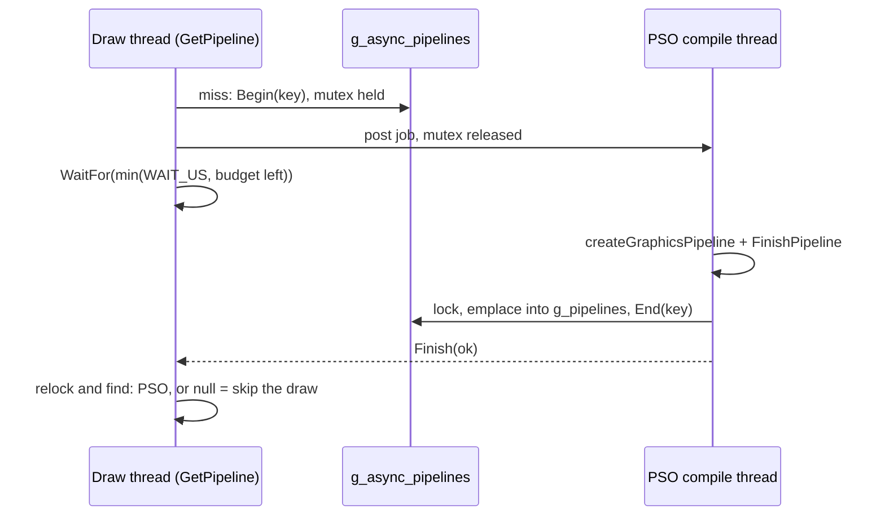

# Async PSO compile (opt-in): task #5 item 4

Agent 6's subagent, 2026-11-21. **Status:** implemented and bench-tested; the default is OFF.

- `draw.cpp` belongs to Agent 4, so its part is a patch: [draw-async.patch](../bench/agent6/draw-async.patch).
- Everything else is already in the live tree.

## Summary

- **Problem:** `GetPipeline` in draw.cpp compiles a PSO synchronously whenever `g_pipelines` misses. With a cold library, every miss is a full driver compile on the recording or preparation thread. That shows up in the `PSO minute` table as `block_ms`, `cfrm` and `hitch`.
- **Change:** with `LEGO_NATIVE_PSO_ASYNC=1`, a miss posts the compile to a small pool of threads named "PSO compile N".
  - The drawing thread waits at most 2 ms for each miss, and at most 4 ms in total per window of about 16.7 ms.
  - If the PSO still isn't ready, `GetPipeline` returns null. The draw is then skipped through the existing "pipeline unavailable" path.
  - A later draw with the same key either joins the compile that is in flight or finds its result.
- **Default (unset):** identical to today. It adds no thread, no allocation, no log and no change of ordering (§3).

## 1. Files

| File | Change | Lines |
|---|---|---|
| `gpu_native/pipeline_async.h` | New, header-only. Holds all of the logic. | 466 |
| `gpu_native/pipeline_creation_gate.h` | `Lease::Release()` | +8 |
| `gpu_native/shaders.h` | `CurrentShaderOwners()` declaration | +4 |
| `gpu_native/shaders.cpp` | `CurrentShaderOwners()` definition | +6 |
| `bench/agent6/draw-async.patch` | The draw.cpp change, for Agent 4 | 7 hunks, +48/−14 |
| `bench/agent6/async_table_test.cpp` | Bench test (run_benches.ps1 `-Only async_table_test`) | ~600 |
| `build/agent6/draw_async/draw.cpp` | The patched copy, for reference. `draw.orig.cpp` is its base. | — |

No frozen file needs a change: `pipeline_library.*`, `pipeline_stats.h`, `pipeline_snapshot.h` and `pipeline_parallel.h` are untouched.

## 2. How it works

### 2.1 GetPipeline with the toggle on

Line numbers refer to draw.cpp sha256 `751C219E…0A99` (19:24:44), the version the patch is against.

1. Lock `g_pipeline_mutex` and look up `g_pipelines`. A hit returns, as today.
2. **New:** look up `g_async_pipelines`. If the key is in flight, call `AwaitAsyncPipeline`:
   - unlock, wait within the budget, then relock;
   - look up `g_pipelines` again;
   - return the PSO, or null, which skips the draw and calls `OnAsyncSkippedDraw`.
3. **As today:** unlock, take the key's creation lease (`g_pipeline_creation.Acquire`), relock and look up `g_pipelines`.
   - **New:** look up `g_async_pipelines` again. If the key is in flight, release the lease and wait as in step 2.
4. **New:** `owners = CurrentShaderOwners()`, before variant resolution.
5. **As today:** variant resolution and the desc. The lease still serializes both.
6. **New, at the compile site** (`auto* device = HostDevice::Device();`, :1819): release the lease, then call `CompilePipelineAsync`, which:
   1. calls `Begin(key)`, registering the compile while the mutex is still held;
   2. unlocks and calls `OnAsyncPosted`;
   3. posts the job;
   4. waits within the budget and relocks;
   5. returns the PSO or null.
7. **The job**, on a pool thread:
   1. runs `FinishPipeline(device->createGraphicsPipeline(owned.desc), owned.desc, key)`;
   2. under `g_pipeline_mutex`, emplaces the PSO into `g_pipelines` if the compile succeeded, then calls `End(key, compile)`;
   3. calls `compile->Finish(ok)` and `OnAsyncFinished(ok)`.

`FinishPipeline` is the synchronous path's post-create code, moved into a function unchanged, so both paths run the same checks:
- the "D3D12 rejected pipeline" log;
- `SetNativePipelineStencilReference`;
- the MRT log.



### 2.2 Components (pipeline_async.h)

- **`AsyncPipelineCompile`:** the completion object, shared by the job and its waiters. It has `Finish(ok)`, `WaitFor(budget_us)`, `Finished()` and `Succeeded()`.
- **`AsyncPipelineTable<Key, Hash>`:** the map of compiles in flight. The caller holds `g_pipeline_mutex`.
  - It has `Find`, `Begin`, `End` (which erases an entry only if it belongs to that compile), `Clear` and `Size`.
  - The first `Begin` allocates the map. The global is therefore constant-initialized, and an unused table owns nothing.
  - Failures are not cached.
- **`AsyncPipelinePool`:** 1–4 threads, named "PSO compile N" via `SetThreadDescription`, each with `pso_stats::t_thread_kind = kAsyncThread`.
  - `Post` runs the job inline if no thread could be started.
  - `Drain` returns once every posted job, queued or running, has finished and destroyed its captures.
  - Each job runs inside a try/catch.
- **`OwnedPipelineDesc<Desc>`:** a copy of `plume::RenderGraphicsPipelineDesc` that owns its `inputSlots`, `inputElements` and `specConstants`. GetPipeline builds those in locals, and the integer-input elements in a thread_local.
  - These stay borrowed: `pipelineLayout`, the shaders, and the element semantic names (string literals, or `UsageName()`).
- **`AsyncWaitBudget`:** the wait budget for each window (§2.4).
- **Glue:**
  - `AsyncPipelineCompileEnabled()`;
  - `PostAsyncPipelineJob(fn)`;
  - `WaitForAsyncPipeline(compile)`, which is true if the PSO is ready within the budget;
  - `DrainAsyncPipelineJobs()`;
  - the GetPipeline helpers `AwaitAsyncPipeline` and `CompilePipelineAsync`, which keep the draw.cpp side small.

### 2.3 Toggles

They are read once, on first use, through a function-local static (thread-safe, no heap). An unset, empty or malformed number keeps its default; any other value is clamped to its range.

| Variable | Default | Range | Meaning |
|---|---|---|---|
| `LEGO_NATIVE_PSO_ASYNC` | off | on when set, nonempty and not `0` | Enables the async path |
| `LEGO_NATIVE_PSO_ASYNC_THREADS` | 2 | 1..4 | Number of compile threads |
| `LEGO_NATIVE_PSO_ASYNC_WAIT_US` | 2000 | 0..1,000,000 | Longest wait for one miss. 0 never waits. |
| `LEGO_NATIVE_PSO_ASYNC_FRAME_US` | 4000 | 0..1,000,000 | Total wait allowed per window of about 16.7 ms |

With the toggle on, one line is logged at first use: `Native GPU: async PSO compile on (threads=2 wait_us=2000 frame_us=4000)`.

### 2.4 Per-frame budget, self-contained

pipeline_library.cpp is frozen, so there is no frame hook. Instead, `AsyncWaitBudget` keeps its own window of 16,667 µs on `steady_clock`.

- **Windows:** a new window starts at the first reservation after the previous window has elapsed.
- **Reserve:** each wait reserves `min(WAIT_US, FRAME_US − used)` up front, so concurrent waiters share the budget.
- **Settle:** afterwards, the budget is charged what the wait really took.
- **Overshoot:** `Finish` wakes a waiter as soon as the compile is done, so only a timeout can overshoot. Without `timeBeginPeriod(1)`, a timeout can run on to the next timer tick. The overshoot is charged, so the rest of the window doesn't wait.
- **Threads:** the budget counts waiting time summed over all threads. That is conservative when preparation workers wait in parallel.

### 2.5 What a posted job owns

- **The desc arrays** (`OwnedPipelineDesc`) and a copy of the key.
- **`owners`:** a `ShaderBindingsSnapshot` of the current bindings.
  - It is `t_shader_bindings` if that is set (for example by the `ShaderBindingsScope` in `InstancedConstantsPipeline`). Otherwise it is `g_bound_shaders`, read under `g_registry_mutex`.
  - It keeps the bound `ShaderResource`s alive, and with them the variant shaders that `desc` points to, because `ShaderResource::variants` is never erased.
  - If the job drops the last reference, that only frees memory. GPU-side retirement is explicit, through `DestroyNativeShader` under `LockRecording`.
- **Borrowed:** the device pointer and `pipelineLayout`. Both outlive `ResetDrawResources`, which drains the jobs first.

A job never touches `g_draw_timing`, which is selected per thread, or any other thread_local draw state.

### 2.6 Locks and teardown

- **Waiting:** waiters never hold `g_pipeline_mutex` while they wait.
- **Publishing:** jobs take `g_pipeline_mutex` only to publish (the emplace plus `End`), never around the compile.
- **Leaf locks:** the pool, compile and budget mutexes.
- **The creation lease** is released before posting. The table entry is registered before the mutex drops, and it takes over the lease's role: later misses wait instead of compiling the same PSO again. Variant resolution and building the desc stay under the lease, as today.
- **Teardown:**
  1. `HostDevice::Shutdown` (device.cpp:923-949, re-checked at 20:54) stops the native worker.
  2. It takes `LockRecording()` and `g_mutex`.
  3. It calls `ResetDrawResources`, which now:
     - calls `DrainAsyncPipelineJobs()` before taking `g_pipeline_mutex`;
     - calls `g_async_pipelines.Clear()` after `g_pipelines.clear()`.

  Jobs need only `g_pipeline_mutex`, the pipeline library's own mutex, the stats counters and the logger. Draining under the recording lock therefore can't deadlock.
- **The runtime** (settings, budget and pool) is created by the first post with the toggle on and published through an atomic pointer.
  - It is leaked, like Plume's caches, so no static destructor joins threads at exit.
  - Idle threads sleep on a condition variable.

## 3. Why the default is identical

With the toggle unset, the patched draw.cpp differs from today only in these ways:

- **`AsyncPipelineCompileEnabled()`** runs once per `g_pipelines` miss, after the first find. It is a function-local static.
  - The first call does one `getenv("LEGO_NATIVE_PSO_ASYNC")`, with no operator new and no log.
  - Later calls just read a bool.
- **Trivial new statements:**
  - two tests of `async ? g_async_pipelines.Find(key) : nullptr`, each constructing an empty `shared_ptr`;
  - one default-constructed, empty `ShaderBindingsSnapshot owners`;
  - one `if (async)` at the compile site.
- **`FinishPipeline`** runs the same code in the same order, still with the lock released. The only move is that `auto* result = pipeline.get()` now comes after the MRT log instead of before it, and a pointer read has no effect.
- **`ResetDrawResources`:** `DrainAsyncPipelineJobs()` loads a null atomic pointer, and `Clear()` resets a null `unique_ptr`.
- **`g_async_pipelines`** is constant-initialized (a null `unique_ptr`), so it has no dynamic initializer.
- **`Lease::Release()` and `CurrentShaderOwners()`** are called only with the toggle on.

Nothing creates a thread unless `PostAsyncPipelineJob` runs with the toggle on, and GetPipeline posts only then. Lookup hits, the hot path, run the same code as before.

**Bench evidence** (`async_table_test`, with the toggle unset in the parent process):
- zero operator-new calls across the off-path entry points;
- no new threads and no "PSO compile" threads;
- `g_async_pipeline_runtime` stays null;
- no log line.

## 4. Side effects with the toggle on

- **Missing geometry for at least one frame.** A draw whose PSO isn't ready within the budget is skipped.
  - A cold compile (10–200+ ms) skips several frames.
  - Warm-library loads usually finish inside the 2 ms wait, so a warm run should skip little.
  - A multi-pass effect can be partial within a frame: one pass skipped, the next drawn.
- **Occlusion queries.** The skip goes through the existing null-pipeline path (draw.cpp:2851-2858): `g_prepared_draw.pipeline.Reset()`, a LongProbe event, then `return false`.
  - The callers then call `FailActiveQueries()` (:4594, :5123, :5133, :5668). It marks every active query as failed and logs `query 0x… invalidated by failed draw`, at most 32 times.
  - `GetData` then returns E_FAIL (0x80004005) for those queries (queries.cpp:173).
  - An effect driven by occlusion (flares, visibility) can therefore misbehave for a frame.
- **LongProbe events.** Each skipped draw raises one `draw_pipeline_unavailable` event (draw.cpp:2856). That is expected with async on and is not an error.
- **Lost render-to-texture content.** If the game renders a texture once and reuses it, and that draw is skipped, the content is missing until the game redraws it.
- **FRAME_METRICS.** `pipeline_creations` and `pipeline_creation_ms` (in `g_draw_timing`, incremented at :1823 and aggregated at :4605) count only synchronous compiles.
  - Async compiles are excluded, so with async on these read about 0.
  - Use the PSO_STATS lines instead (§6).
- **Failed compiles re-post, with no backoff.** A failure isn't cached, so the next miss posts again.
  - The synchronous path does the same today: it compiles again on every draw.
  - The difference is the cost to the draw thread: it waits at most WAIT_US per miss and FRAME_US per window, instead of a full compile.
  - Failures are rare; they appear as the "D3D12 rejected pipeline" log.
  - A key that fails persistently costs pool CPU plus the per-window wait.
  - A backoff that remembers failed keys for N windows can be added in pipeline_async.h if PSO_STATS shows `failed` climbing.
- **Instanced draws** (`InstancedConstantsPipeline`, :1846) go through GetPipeline, so they are async too. A null there falls back to the per-draw path (:4401-4411). That costs no geometry, only the slower path for that frame.
- **`GetTemporalPipeline` (:1858) stays synchronous.** It has its own cache and gate.
- **CPU.** There are 2 extra threads by default, idle on a condition variable when not compiling. On 4 cores, consider `LEGO_NATIVE_PSO_ASYNC_THREADS=1`.
- **Stats.** `waits` counts every wait, including those with no budget left. A wait with no budget left lasts 0 ns, and counts as a timeout if the compile hadn't finished.

## 5. Applying the patch (Agent 4)

These prerequisites are already in the live tree, and in S1:
- `pipeline_async.h`;
- `Lease::Release()`;
- `CurrentShaderOwners()`.

Run from the workspace root:

```powershell
git -C DimensionsRecomp apply --check -v ../bench/agent6/draw-async.patch
git -C DimensionsRecomp apply ../bench/agent6/draw-async.patch
```

- **Base version:** the patch is against draw.cpp sha256 `751C219E…0A99`.
- **Paths and line endings:** its paths are relative to the DimensionsRecomp repo (`rexlego/src/gpu_native/draw.cpp`) and its content lines are CRLF, so `git apply` keeps the file CRLF. `patch -p1`, run from DimensionsRecomp, also works.
- **Don't run `git apply` from the workspace root.** The root sits inside the outer `C:/Users/<user>/.vscode/projects` repo. Git would resolve the paths against that repo and silently skip the file.
- **Verified:**
  - `apply --check` passes on the live file.
  - Applying the patch to the base copy reproduces `build/agent6/draw_async/draw.cpp` byte for byte (sha256 `50AA3B1D…BDD6`).
  - That copy passed a `-fsyntax-only` compile with draw.cpp's own command line from `build/dev/compile_commands.json`, plus one `-I` for its relative include (`build/agent6/draw_async/check.ps1`).
- **If draw.cpp has moved on** and the patch doesn't apply, make these 5 edits by hand, using `build/agent6/draw_async/draw.cpp` as the reference:
  1. Add `#include "gpu_native/pipeline_async.h"`.
  2. Add `AsyncPipelineTable<PipelineKey, PipelineKeyHash> g_async_pipelines;` after `g_pipelines`.
  3. Add `FinishPipeline()` before `GetPipeline`, and make the synchronous path call it.
  4. In GetPipeline:
     - add the two in-flight checks after the two `g_pipelines` finds;
     - add `owners` before variant resolution;
     - add the `if (async)` branch after `auto* device = HostDevice::Device();`.
  5. In `ResetDrawResources`, add `DrainAsyncPipelineJobs();` before the `lock_guard`, and `g_async_pipelines.Clear();` after `g_pipelines.clear();`.

## 6. In-game A/B

This is P5 (`pso-async`) in the [agent6-runspecs.md](agent6-runspecs.md) matrix: the same build, route and cache state, with async off and then on. Add `;LEGO_NATIVE_PSO_STATS=1` to every run, as in P1–P3.

| Pair | Off | On | Cache |
|---|---|---|---|
| Primary | P1 (`pso-cold`) | P5: `;LEGO_NATIVE_PSO_ASYNC=1` | cold, a fresh run dir |
| Warm | P2 (`pso-warm`) | P2 + `;LEGO_NATIVE_PSO_ASYNC=1` | `-SeedCache <P1 run>\cache` |
| Worst case | P3 (`pso-nocache`) | P3 + `;LEGO_NATIVE_PSO_ASYNC=1` | `LEGO_NATIVE_PSO_CACHE=0` |

- Optionally, add `LEGO_NATIVE_PSO_STATS_INTERVAL=10`.
- Second-round variants:
  - `LEGO_NATIVE_PSO_ASYNC_WAIT_US=0`: never wait, which gives the most skipping and the least stall;
  - `LEGO_NATIVE_PSO_ASYNC_THREADS=1`.

**Compare in `game.log`:**

- **`PSO frames:`** gives hitches of 50 ms or more, frames with 4 ms or more of blocking compiles, the frame-time histogram and the worst frame. **Expected:** in the cold pairs, both counts fall sharply with async on.
- **`PSO compiles by thread: present … async … other …`:** with async on, the GetPipeline compiles should move to `async`. `present` and `other` should keep only compiles made outside GetPipeline, such as `GetTemporalPipeline`.
- **`PSO async: N posted, N ready, N failed, N skipped draws, N waits (ms), N timeouts`** appears only with async on. A healthy run has:
  - `failed` near 0;
  - skipped draws concentrated in the first minutes and at area entries;
  - total wait ms of at most FRAME_US per 16.7 ms window.
- **`PSO minute` table:** `comp`, `block_ms`, `cfrm` and `hitch` should fall. The `skip` column counts skipped draws per minute.
- **FRAME_METRICS:** `pipeline_creations` drops to about 0 with async on, because async compiles aren't counted there.

**Watch the screen and the log for:**
- pop-in on first entry to an area;
- missing one-shot render-to-texture content (portraits, UI renders);
- flickering occlusion effects;
- `invalidated by failed draw` warnings.

**Ship criteria:**
- **Cold pairs:** a clear drop in `hitch`, `cfrm` and `block_ms`, and no visual defect that lasts more than a few frames.
- **Warm pair:** no regression, and few skipped draws.
